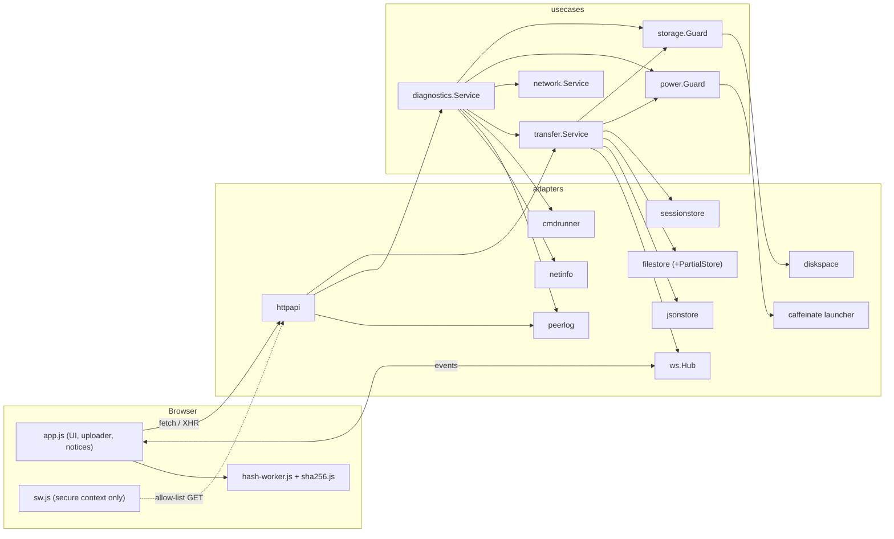
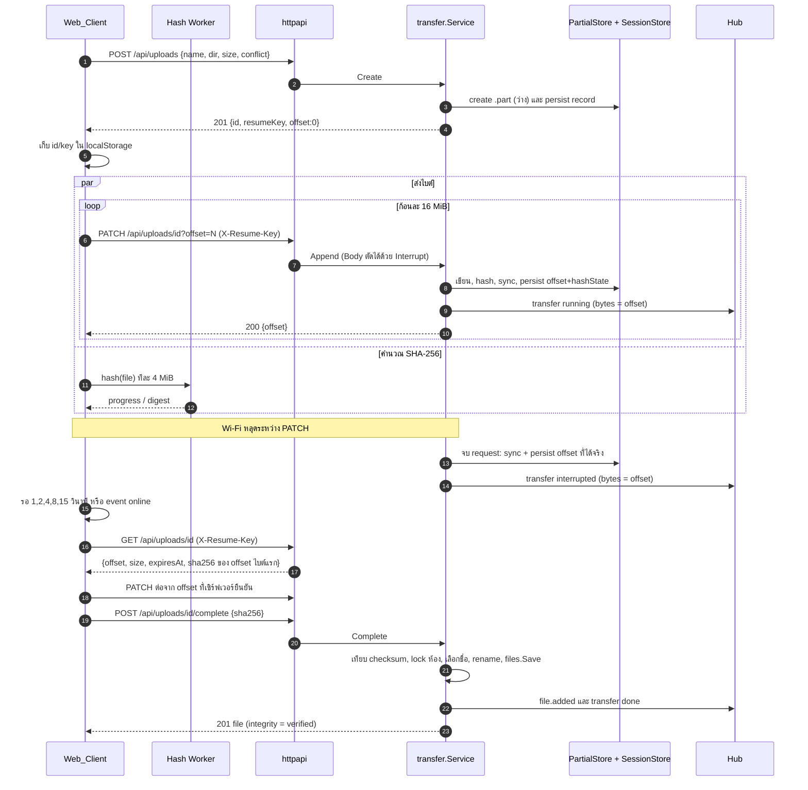
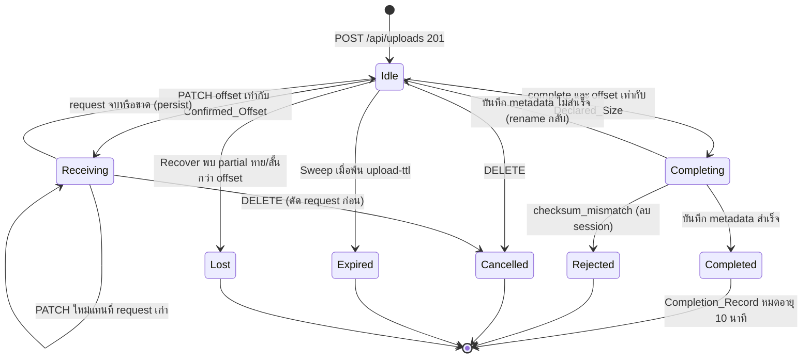
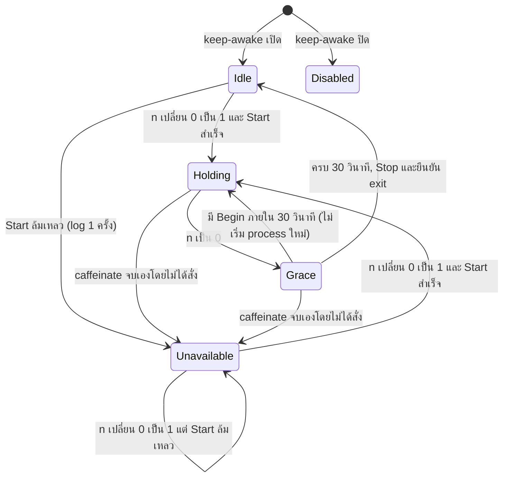

# Design Document: reliable-transfers (Phase C "ความเสถียร")

## Overview

เอกสารนี้ออกแบบ 18 requirements ใน `requirements.md` โดยต่อยอดจากโค้ด Phase A และ B ที่มีอยู่จริง (module `lanshare`, Clean Architecture ใต้ `internal/`) ไม่เปลี่ยนโครงสร้างชั้นเดิม และยังไม่แก้โค้ดใดๆ ในขั้นนี้

ฟีเจอร์ทั้ง 6 กลุ่มและแนวทางหลัก

| กลุ่ม | แนวทางหลัก | Requirements |
|---|---|---|
| Resumable upload | `Upload_Session` ที่ persist ต่อไฟล์ใน `<data>/sessions/<id>.json`, ไฟล์ชั่วคราวใน `<data>/partial/<room>/<id>.part`, endpoint `/api/uploads...` ใหม่ ใช้ header `X-Resume-Key` | 1-6, 12 |
| ตรวจ SHA-256 | เซิร์ฟเวอร์คำนวณ SHA-256 ระหว่างเขียน เก็บสถานะ hash ภายใน (`encoding.BinaryMarshaler`) คู่กับ offset, เบราว์เซอร์คำนวณใน Web Worker ด้วย JS ที่ฝังมากับแอป | 8, 9, 10 |
| กัน Mac หลับ | `power.Guard` เป็น state machine ที่รับ `Begin/End/Hold/Release` และสั่ง `caffeinate -i -w <pid>` ผ่าน port | 13 |
| ตรวจปัญหาการเชื่อมต่อ | `diagnostics.Service` รัน 7 checks พร้อมกัน มี timeout และ cache 30 วินาที, หน้า UI เฉพาะ Owner | 14, 15 |
| PWA และแจ้งเตือน | `manifest.webmanifest`, ไอคอน, `sw.js` แบบ network-first พร้อม allow-list, เปิดใช้เฉพาะ Secure_Context | 16, 17 |
| ตรวจพื้นที่ดิสก์ และ config | `storage.Guard` จองพื้นที่ใน ledger ภายใต้ mutex, flag ใหม่ 4 ตัวพร้อม `ParseSize/FormatSize` | 7, 18 |

### ข้อเท็จจริงที่ตรวจแล้วและมีผลต่อการออกแบบ

ตรวจจากโค้ดในรีโปและ standard library ของ go1.27.0 บนเครื่องนี้ (macOS 26.6.2)

- **SHA-256 state serialize ได้จริง:** `crypto/sha256.New()` คืน digest ที่ implement `encoding.BinaryMarshaler` และ `BinaryUnmarshaler` ขนาด 108 ไบต์ (ผมรันโปรแกรมทดสอบแยกใน `/tmp` แล้ว: marshal หลังเขียน `"hello "`, unmarshal ลง digest ใหม่, เขียนต่อ `"world"` ได้ผลเท่ากับ `sha256.Sum256("hello world")`) จึงไม่ต้องอ่าน Partial_File ซ้ำตอนต่ออัปโหลด (Req 8.3) ข้อควรระวัง: ต้อง assert type ตอนรัน และ persist ค่า magic prefix ไปด้วยโดยไม่ตีความเอง
- **ตัด request ที่ค้างอ่าน body ได้:** `http.ResponseController.SetReadDeadline` มีอยู่ และ `net/http` ตั้ง read deadline ใหม่ทุกครั้งที่อ่าน request ถัดไปบน connection เดิม (`server.go` บรรทัด `c.rwc.SetReadDeadline(wholeReqDeadline)`) การตั้ง deadline ย้อนหลังเพื่อปลุก `Read` จึงไม่ค้างข้ามไปยัง request อื่น วิธีนี้ใช้ทั้ง Stall_Timeout (Req 2.7) และการแทนที่ request เก่า (Req 2.6) โดยไม่ต้องตั้ง `ReadTimeout` ทั้งเซิร์ฟเวอร์
- **fsync บน macOS:** `os.File.Sync` บน darwin เรียก `fcntl(F_FULLFSYNC)` (`internal/poll/fd_fsync_darwin.go`) ซึ่งช้ากว่า fsync ปกติ จึงต้อง sync ต่อ append request และทุก 64 MiB เท่านั้น ไม่ใช่ทุกก้อน 1 MiB
- **ดิสก์เต็ม:** `syscall.ENOSPC` และ `syscall.EDQUOT` มีบน darwin ใช้ `errors.Is` แปลงเป็น `domain.ErrDiskFull` ใน adapter
- **พื้นที่ว่าง:** `syscall.Statfs` และ `Statfs_t{Bsize uint32, Bavail uint64}` มีใน stdlib บน darwin ไม่ต้องเพิ่ม `golang.org/x/sys` เป็น dependency ตรง (`go.mod` ปัจจุบันมี 3 dependency และไม่มี `x/sys`) ชนิดของ `Bsize` ต่างกันตามระบบ จึงแปลงเป็น `uint64` ก่อนคูณ
- **`caffeinate`:** man page ยืนยันว่ารับ `-i` (กัน idle sleep) และ `-w pid` (ปล่อย assertion เมื่อ process นั้นจบ) และ `-s` ทำงานเฉพาะตอนเสียบไฟ AC ใช้ `-i -w` ตามที่ requirements กำหนด
- **Wi-Fi band:** บน macOS 26.6.2 ไม่มีไบนารี `airport` แล้ว (`/System/Library/PrivateFrameworks/Apple80211.framework/.../airport` ไม่พบ) ใช้ `system_profiler SPAirPortDataType -json` แทน ได้ฟิลด์ `spairport_current_network_information.spairport_network_channel` รูปแบบ `"149 (5GHz, 20MHz)"` ต่อ interface (เช่น `en0`) คำสั่งนี้ใช้เวลา ~5 วินาทีบนเครื่องนี้ จึงต้องมี timeout 10 วินาทีตาม Req 14.16 และห้าม parse ส่วน "Other Local Wi-Fi Networks" (เฉพาะ JSON ที่ระบุ interface จึงไม่ปนกัน)
- **Firewall:** `socketfilterfw --getglobalstate` คืน `Firewall is disabled. (State = 0)` และ `--getappblocked <path>` คืน `Incoming connection to <path> is permitted.` (ตรวจแล้วบนเครื่องนี้ในกรณี Firewall ปิด) ข้อความของกรณี Firewall เปิดและโปรแกรมถูกบล็อกหรือยังไม่เคยอยู่ในรายการ **ยังไม่ได้ตรวจ** ตัว parser จึงต้องคืน `unknown` พร้อม reason `parse_failed` เมื่อเจอข้อความที่ไม่รู้จัก ไม่เดา
- **CSP ปัจจุบัน** (`script-src 'self'`, ไม่มี `worker-src`) ครอบคลุม Web Worker, `importScripts` และ Service Worker จาก origin เดียวกัน แต่ **ไม่ครอบคลุม WebAssembly** (ต้องมี `'wasm-unsafe-eval'`) จึงเลือก SHA-256 เป็น JavaScript ล้วน ไม่ใช้ WASM เพื่อไม่ต้องผ่อน CSP (Req 16.4)
- **`GET /api/files/{id}` คือดาวน์โหลด** ไม่มี endpoint metadata รายไฟล์ และ event `file.added` ส่งเฉพาะ `FileID` การแจ้งเตือน (Req 17) จึงใช้ `GET /api/files` ที่ client เรียกอยู่แล้วหลังได้ event โดยไม่เพิ่ม endpoint
- **Hub ส่งทุก event ให้ทุก connection ในห้อง** รวมบทบาท `uploader` (ดูความเสี่ยงข้อ 4)

### การตัดสินใจหลัก (Design Decisions)

| # | การตัดสินใจ | เหตุผล |
|---|---|---|
| D1 | ขยาย `transfer.Service` (แยกไฟล์ `session.go`, `publish.go`, `integrity.go`, `janitor.go`) ไม่สร้าง use case แยก | การ publish ไฟล์ (เลือกชื่อ, เขียนทับ, event, lock ต่อห้อง) ต้องใช้ร่วมกันระหว่าง `POST /api/files` และการ complete session ถ้าแยกแพ็กเกจจะต้องให้ use case เรียกกันเอง `NewService` เดิมไม่เปลี่ยน เพิ่ม `ConfigureUploads(...)` เพื่อไม่ให้เทสต์เดิมพัง |
| D2 | Session หนึ่งไฟล์ต่อหนึ่ง record ใน `sessions/<id>.json` ไม่เก็บใน `state.json` | `jsonstore` เขียนทั้งไฟล์ใหม่ทุกครั้งที่ `Save` การ persist offset ทุก append ของหลาย session จะแพงและแย่งล็อกกับ metadata ไฟล์ |
| D3 | Resume_Key เก็บเป็น SHA-256 ของคีย์ (`resumeKeyHash`) ไม่เก็บคีย์ดิบ | state file ถูกอ่านได้ถ้าเครื่องถูกเข้าถึง การเก็บแฮชทำให้คีย์ 128 บิตรั่วจากไฟล์ไม่ได้ ผลต่อ Req 4.8 ดูหัวข้อความเสี่ยง |
| D4 | Session ID และ Resume_Key สุ่มแยกกัน 128 บิตจาก `crypto/rand` ผ่าน port `SecretGenerator` | Req 5.7 ห้ามให้ค่าหนึ่งอนุมานอีกค่าได้ และเทสต์ต้อง inject ค่าที่คาดเดาได้ |
| D5 | Query ระหว่างมี append วิ่งอยู่ คืนค่าที่ **persist แล้ว** ไม่คืนค่า live | ทุก offset ที่ตอบ client ต้อง durable (Req 4.4) client ที่ได้ค่าต่ำกว่าจริงจะได้ `409 offset_mismatch` พร้อม offset ใหม่และส่งต่อทันที (Req 11.13) |
| D6 | persist record ตอนจบแต่ละ append request และทุก 64 MiB ระหว่าง request | จำกัดงานที่เสียเมื่อโปรเซสถูกฆ่า โดยไม่ต้อง `F_FULLFSYNC` ทุกก้อน |
| D7 | เขียน partial file ก่อน แล้ว sync แล้วค่อย persist record (ลำดับบังคับ) | record จะไม่มีวันอ้าง offset มากกว่าที่อยู่บนดิสก์จริง รวมถึงกรณีไฟดับ |
| D8 | completion ใช้ `rename` partial เป็นไฟล์ปลายทางในไดรฟ์เดียวกัน แล้วค่อย `files.Save` และหากบันทึก metadata ไม่สำเร็จให้ **rename กลับ** | ไฟล์หลาย GB ไม่ต้องคัดลอก, ไม่มีเนื้อหาค้างโดยไม่มี metadata (Req 3.5) และไม่ทิ้งงานที่ส่งมาแล้ว |
| D9 | ใช้ `rapid` (pgregory.net/rapid) สำหรับ property test ฝั่ง Go และ `fast-check` ฝั่ง JS | ดูหัวข้อ Testing Strategy |
| D10 | SHA-256 ฝั่ง browser เป็น JS ล้วนใน classic Web Worker โหลดด้วย `importScripts` | `crypto.subtle` ใช้ไม่ได้บน HTTP (ไม่ใช่ Secure_Context) และ WASM ติด CSP |
| D11 | ความคืบหน้าของอัปโหลดที่ต่อได้ใช้ค่า `bytes` จาก event `transfer` ของตัวเองผ่าน WebSocket (ผสมกับ offset ใน response) | Req 11.11 ให้ใช้เฉพาะ Confirmed_Offset จากเซิร์ฟเวอร์ แต่ก้อนละ 16 MiB หยาบเกินไปบนมือถือ |
| D12 | `Power_Guard` และ `Storage_Guard` เป็น state machine/ledger ล้วน รับ clock และ port เข้ามา | ทดสอบด้วย fake clock และ property test ได้ตาม Req 13.9 และ 7.8 |

### นอกขอบเขต

ตามที่ requirements ระบุ: HTTPS, การอนุมัติอุปกรณ์, โควตาต่อห้อง, Web Push, bit-rot scan, การอัปโหลดหลายการเชื่อมต่อขนานต่อไฟล์เดียว และโฮสต์ที่ไม่ใช่ macOS (ส่วน `diskspace` ใช้ build tag `darwin || linux` และมี stub ที่คืน error บนระบบอื่น แต่ไม่ถือว่ารองรับ)

## Architecture

### การวางชั้นและแพ็กเกจใหม่

ทิศทาง dependency ไม่เปลี่ยน: `cmd` → `adapter`/`infra` → `usecase` → `domain`

```
internal/
├── domain/
│   ├── upload.go          # UploadSession, SessionID, ValidDeclaredSize, resume key hashing
│   ├── integrity.go       # Integrity, NormalizeChecksum (hex 64 ตัว)
│   ├── check.go           # CheckResult, CheckStatus, PowerStatus
│   ├── errors.go          # (เพิ่ม) typed errors ใหม่
│   ├── file.go            # (แก้) File.SHA256, File.Integrity
│   └── network.go         # (แก้) NetInterface.PrefixLen
├── usecase/
│   ├── port/port.go       # (เพิ่ม) UploadSessionRepository, PartialStore, DiskSpace, SecretGenerator,
│   │                      #   ActivityTracker, CaffeinateLauncher, CommandRunner, PeerLog, LocalAddrProvider
│   │                      #   และ FileRepository.SetChecksum
│   ├── transfer/
│   │   ├── transfer.go    # (แก้) Upload ใช้ publish ร่วม, tracker รองรับ interrupted, Open/zip เรียก activity
│   │   ├── session.go     # Create / Append / Query / Complete / Cancel
│   │   ├── publish.go     # roomLock, resolve ชื่อ, overwrite, publish (ใช้ร่วม)
│   │   ├── integrity.go   # lazy checksum (คิว 1 งาน, timeout 60 วินาที)
│   │   └── janitor.go     # Recover (ตอนเริ่ม) และ Sweep (ทุก 1 นาที)
│   ├── storage/guard.go   # ledger การจองพื้นที่ + อ่านพื้นที่ว่าง
│   ├── power/guard.go     # state machine กันหลับ
│   ├── diagnostics/       # service.go, checks_*.go, reach.go (ฟังก์ชันล้วน), parse.go (ฟังก์ชันล้วน)
│   └── fake/fake.go       # (เพิ่ม) Sessions, Partials, Disk, Secrets, Activity, Runner, Launcher
├── adapter/
│   ├── sessionstore/      # implement UploadSessionRepository (ไฟล์ละ session, atomic + fsync)
│   ├── filestore/         # (แก้) implement PartialStore, map ENOSPC → ErrDiskFull
│   ├── diskspace/         # implement DiskSpace ด้วย syscall.Statfs
│   ├── cmdrunner/         # implement CommandRunner (os/exec + context timeout)
│   ├── caffeinate/        # implement CaffeinateLauncher
│   ├── peerlog/           # implement PeerLog (in-memory, ตัดข้อมูลเก่ากว่า 10 นาที)
│   ├── jsonstore/         # (แก้) sha256/integrity ใน fileDTO + SetChecksum
│   ├── netinfo/           # (แก้) เติม PrefixLen, เพิ่ม LocalAddrs
│   └── httpapi/           # (แก้) routes ใหม่, DTO, static/PWA, middleware recordPeer
└── infra/
    ├── config/            # (แก้) flag ใหม่ + size.go (ParseSize/FormatSize)
    └── system/            # (เพิ่ม) SecretGenerator
web/
├── index.html app.js style.css            # (แก้)
├── sha256.js hash-core.js hash-worker.js  # (ใหม่) ฝังด้วย embed
├── sw.js manifest.webmanifest icons/*.png # (ใหม่) ฝังด้วย embed
└── embed.go                               # (แก้) //go:embed รายการไฟล์ใหม่ + icons
```

ไฟล์ทดสอบฝั่ง JS (`*.test.js`, `package.json` สำหรับ `fast-check`) วางใน `web/test/` และ **ไม่อยู่ใน `//go:embed`** จึงไม่ถูกส่งให้ผู้ใช้

### Component diagram



### Resume flow (อัปโหลดหลุดแล้วต่อ)



### State ของ Upload_Session



### Startup และ shutdown (cmd/lanshare/main.go)

ลำดับตอนเริ่ม ต้องเกิดก่อน `net.Listen` (Req 4.5, 18.4)

1. `config.Load` (ล้มเหลว → exit 1 ก่อนแตะดิสก์หรือพอร์ต)
2. `MkdirAll(DataDir)` แล้วสร้าง adapter และ use case
3. log INFO ค่า config ที่ใช้จริง 4 ค่า (Req 18.7)
4. `transferSvc.Recover(ctx)` (ลบ partial กำพร้า, ตัด/ลบ session ที่ไม่ตรง, ลบ `.upload-*` เก่ากว่า 1 ชั่วโมง)
5. เริ่ม goroutine: `transferSvc.RunJanitor(ctx)` (ทุก 1 นาที), `power.Run(ctx)` (tick 500 ms)
6. `net.Listen` แล้ว `Serve`

ลำดับตอนปิด (SIGINT/SIGTERM)

1. `transferSvc.BeginShutdown()` เรียก `Interrupt()` ของทุก append ที่กำลังวิ่ง แล้วรอให้ persist เสร็จสูงสุด 3 วินาที (Req 2.3)
2. `srv.Shutdown` (รอสูงสุด 5 วินาทีเหมือนเดิม แล้ว `Close`)
3. `power.Stop(ctx 2s)` ฆ่า `caffeinate` และรอจน exit (Req 13.5)

กรณี `SIGKILL` หรือ crash: ไม่มีโอกาส persist ครั้งสุดท้าย จึงอาศัยการ truncate ตอน Recover (Req 4.6) และ `caffeinate -w <pid>` (Req 13.6)

### Concurrency model

| ทรัพยากร | กลไก | กฎ |
|---|---|---|
| Registry ของ session (`map[SessionID]*sessionRT`, จำนวนต่ออุปกรณ์/ห้อง) | `Service.regMu` | ถือสั้นๆ เพื่ออ่าน/เพิ่ม/ลบ ห้ามทำ I/O ขณะถือ |
| สถานะต่อ session (`rec`, `active`, `completing`, `dead`) | `sessionRT.mu` | ถือเฉพาะตอนอ่าน/เปลี่ยนสถานะ ไม่ถือขณะอ่าน body หรือเขียนดิสก์ก้อนใหญ่ |
| เพียงหนึ่ง append ต่อ session | `sessionRT.active *appendRun` | request ใหม่เรียก `run.interrupt()` แล้วรอ `run.done` สูงสุด 5 วินาที มิฉะนั้น `409 upload_busy` (Req 2.6) |
| การ publish ไฟล์ (เลือกชื่อ, Save, ลบของเก่า) | `Service.roomLock(room)` (mutex ต่อห้อง) | ครอบทั้ง `POST /api/files` และ complete เพื่อให้ Req 6.9 และ 6.5 เป็นจริง |
| Ledger พื้นที่ | `storage.Guard.mu` | ตรวจและลงทะเบียนในช่วงเดียวกัน (Req 7.9) |
| Power state | `power.Guard.mu` | ใช้ clock ที่ inject |
| Checksum งานเก่า | semaphore ขนาด 1 + timeout 60 วินาที | Req 8.8-8.9 |

ลำดับการล็อก (ห้ามย้อน): `regMu` → `sessionRT.mu` → (ปล่อย) → `roomLock` → `Guard.mu` / `jsonstore.mu` ซึ่งเป็น leaf การ complete ตั้งธง `completing` ภายใต้ `sessionRT.mu` ก่อน แล้วปล่อยก่อนเข้า `roomLock`

หน่วยความจำต่อ append: buffer 1 MiB หนึ่งก้อนจาก `sync.Pool` (Req 2.10, 8.1) ไม่เก็บ `hash.Hash` ค้างระหว่าง request สร้างจาก `HashState` ที่ persist ไว้ตอนเริ่ม append แล้ว marshal กลับตอนจบ

## Components and Interfaces

### Domain (ไม่ import HTTP/SQL/ไฟล์)

```go
// domain/upload.go
type SessionID string

const MaxDeclaredSize = 1<<53 - 1 // 9007199254740991, ปลอดภัยสำหรับ JS Number

type UploadSession struct {
    ID            SessionID
    RoomID        RoomID
    CreatorID     DeviceID
    CreatorName   string // ใช้เป็น deviceName ใน Progress
    Name          string // ผ่าน SanitizeFileName แล้ว
    Dir           string // ผ่าน SanitizeDir แล้ว
    Declared      int64  // 0..MaxDeclaredSize
    Conflict      string // "rename" | "overwrite"
    Offset        int64  // Confirmed_Offset ที่ persist แล้ว
    HashState     []byte // sha256 MarshalBinary ของ Offset ไบต์แรก
    ResumeKeyHash string // hex ของ sha256(resumeKey)
    CreatedAt     time.Time
    LastWriteAt   time.Time // เวลา append ที่เขียนอย่างน้อย 1 ไบต์ล่าสุด (ศูนย์ = ยังไม่เคย)
}

func (s UploadSession) Valid() error              // 0 <= Offset <= Declared, ชื่อ/Dir ผ่าน sanitize ซ้ำแล้วไม่เปลี่ยน
func (s UploadSession) ExpiresAt(ttl time.Duration) time.Time // max(CreatedAt, LastWriteAt) + ttl
func HashResumeKey(key string) string
func (s UploadSession) CheckResumeKey(key string) bool        // เทียบแบบ constant time

// domain/integrity.go
type Integrity string
const (IntegrityVerified Integrity = "verified"; IntegrityUnverified = "unverified"; IntegrityUnknown = "unknown")
func NormalizeChecksum(s string) (string, error) // 64 ตัว [0-9a-fA-F] → lowercase; อย่างอื่น ErrInvalidInput
const EmptySHA256 = "e3b0c44298fc1c149afbf4c8996fb92427ae41e4649b934ca495991b7852b855"
```

`domain.File` เพิ่ม `SHA256 string` และ `Integrity Integrity` (ค่าว่าง = `unknown`) เมธอด `File.IntegrityOrUnknown()` ใช้ตอนแปลงเป็น DTO

Typed errors ใหม่ใน `domain/errors.go` (ทุกตัวมี `Unwrap` ไปยัง sentinel เมื่อเหมาะสม)

| Error | ข้อมูล | HTTP |
|---|---|---|
| `*OffsetMismatchError` | `Offset int64` | 409 `offset_mismatch` |
| `ErrUploadBusy` | | 409 `upload_busy` |
| `*IncompleteError` | `Offset, Declared` | 409 `incomplete` |
| `*SizeExceededError` | | 413 `size_exceeded` |
| `ErrStallTimeout` | | 408 `stall_timeout` |
| `ErrTooManyUploads` | | 429 `too_many_uploads` |
| `*InsufficientStorageError` | `Required, Available uint64` | 507 `insufficient_storage` |
| `*ChecksumMismatchError` | `Supplied, Computed string` | 422 `checksum_mismatch` |
| `*PersistFailedError` | `Offset int64` | 500 `persist_failed` |
| `ErrChecksumBusy` / `ErrChecksumFailed` | | 503 `checksum_busy` / 500 `checksum_failed` |
| `ErrDiskFull` | (จาก adapter) | ถูกแปลงเป็น `InsufficientStorageError` ใน use case |
| `ErrInterrupted` | | ภายในเท่านั้น |

### Ports ที่เพิ่มหรือแก้ (`usecase/port/port.go`)

```go
// แก้: FileRepository เพิ่มเมธอดเดียว แก้ไขเฉพาะ checksum แบบอะตอมมิก
// คืน ErrNotFound ถ้าไฟล์ถูกลบหรือถูกแทนที่แล้ว (ไม่ "ชุบชีวิต" ไฟล์ที่ถูกลบ)
SetChecksum(ctx context.Context, room domain.RoomID, id domain.FileID, sha256hex string) error

type UploadSessionRepository interface {
    // Save เขียนแบบอะตอมมิกและ durable: เขียนไฟล์ชั่วคราว, fsync, rename, fsync โฟลเดอร์
    Save(ctx context.Context, s domain.UploadSession) error
    Delete(ctx context.Context, room domain.RoomID, id domain.SessionID) error
    // LoadAll คืน record ที่ parse ได้ และรายชื่อไฟล์ที่ parse ไม่ได้ (corrupt) ให้ janitor ลบ
    LoadAll(ctx context.Context) (ok []domain.UploadSession, corrupt []string, err error)
}

type PartialRef struct { Room domain.RoomID; ID domain.SessionID; Size int64 }

type PartialWriter interface { io.Writer; Sync() error; Close() error }

type PartialStore interface {
    Create(ctx context.Context, room domain.RoomID, id domain.SessionID) error
    // OpenAppend ตัดไฟล์ให้เหลือ offset ไบต์แล้วเขียนต่อจากนั้น (คืน ErrNotFound ถ้าไม่มีไฟล์)
    OpenAppend(ctx context.Context, room domain.RoomID, id domain.SessionID, offset int64) (PartialWriter, error)
    Size(ctx context.Context, room domain.RoomID, id domain.SessionID) (int64, error)
    Truncate(ctx context.Context, room domain.RoomID, id domain.SessionID, size int64) error
    Delete(ctx context.Context, room domain.RoomID, id domain.SessionID) error
    // Promote ย้าย partial เป็นไฟล์ปลายทาง rooms/<room>/<fileID> (rename อะตอมมิก, ไดรฟ์เดียวกัน)
    Promote(ctx context.Context, room domain.RoomID, id domain.SessionID, file domain.FileID) error
    // Demote ย้ายกลับ (ใช้ตอน rollback)
    Demote(ctx context.Context, room domain.RoomID, file domain.FileID, id domain.SessionID) error
    List(ctx context.Context) ([]PartialRef, error)
    // SweepLegacyTemp ลบ rooms/*/.upload-* ที่แก้ไขล่าสุดก่อน before คืนจำนวนที่ลบ
    SweepLegacyTemp(ctx context.Context, before time.Time) (int, error)
}

type DiskSpace interface {
    // Free คืนไบต์ที่ผู้ใช้ทั่วไปใช้ได้ (Bavail*Bsize) ของไดรฟ์ที่เก็บ Data_Dir
    Free(ctx context.Context) (uint64, error)
}

type SecretGenerator interface{ NewSecret() string } // 128 บิต hex

// ActivityTracker บอก power.Guard ว่ามี Active_Transfer
type ActivityTracker interface {
    Begin() (end func())                       // คู่ Begin/end ต่อ request หรือการดาวน์โหลด
    Hold(key string, ttl time.Duration)        // session ที่ยังไม่เสร็จหลัง request จบ (60 วินาที)
    Release(key string)
}

type CaffeinateProcess interface {
    Stop(ctx context.Context) error            // ส่งสัญญาณและรอ exit
    Exited() <-chan error                      // ปิดเมื่อ process จบ (ใช้ตรวจจบเอง)
}
type CaffeinateLauncher interface{ Start(pid int) (CaffeinateProcess, error) }

type CommandRunner interface {
    // Run รัน name args โดย ctx เป็นตัวกำหนด timeout คืน stdout เท่านั้น
    Run(ctx context.Context, name string, args ...string) ([]byte, error)
}

type PeerLog interface {
    Record(ip netip.Addr, at time.Time)
    Since(t time.Time) []PeerSeen                 // PeerSeen{Addr, LastSeen}
}

type LocalAddrProvider interface{ LocalAddrs(ctx context.Context) ([]netip.Addr, error) }
```

`domain.NetInterface` เพิ่ม `PrefixLen int` (เทสต์เดิมใช้ named field จึงคอมไพล์ผ่านต่อ) `netinfo.Provider` เติมค่าจาก `ipnet.Mask.Size()` และ implement `LocalAddrs` (IPv4 และ IPv6 ทุก address ของทุก interface)

### transfer.Service: การตั้งค่าและ API

```go
type UploadDeps struct {
    Sessions port.UploadSessionRepository
    Partials port.PartialStore
    Guard    *storage.Guard
    Secrets  port.SecretGenerator
    Activity port.ActivityTracker // nil = ไม่ทำอะไร
}
type UploadConfig struct {
    TTL          time.Duration // -upload-ttl
    StallTimeout time.Duration // -stall-timeout
    CompletionKeep time.Duration // 10 นาที (Completion_Record)
}
func (s *Service) ConfigureUploads(d UploadDeps, c UploadConfig)

type AppendBody interface {
    io.Reader
    Interrupt() // ทำให้ Read ที่ค้างอยู่ (และครั้งถัดไป) คืน error ทันที
}

func (s *Service) CreateSession(ctx, actor domain.Device, in CreateInput) (CreatedSession, error)
func (s *Service) Append(ctx, actor domain.Device, id domain.SessionID, key string, offset int64, contentLength int64, body AppendBody) (AppendResult, error)
func (s *Service) QuerySession(ctx, actor, id, key) (SessionInfo, error)
func (s *Service) CompleteSession(ctx, actor, id, key string, checksum *string) (CompleteResult, error) // Repeated bool
func (s *Service) CancelSession(ctx, actor, id, key string) error      // Owner ข้าม key ได้ (ห้องเดียวกัน)
func (s *Service) FileChecksum(ctx, actor, id domain.FileID) (ChecksumInfo, error)
func (s *Service) ListSessions(ctx, owner domain.Device) ([]SessionSummary, error)   // ไม่มี Resume_Key, ไม่มีชื่อไฟล์
func (s *Service) CancelByOwner(ctx, owner domain.Device, id domain.SessionID) error
func (s *Service) PartialBytes() int64                                   // ผลรวม Offset ใช้ใน diagnostics
func (s *Service) Recover(ctx) error
func (s *Service) RunJanitor(ctx)
func (s *Service) BeginShutdown(ctx)
```

#### อัลกอริทึม CreateSession (Req 1, 5.6, 7)

ลำดับการตรวจ (ล้มเหลวที่ขั้นใด ไม่สร้างอะไรเลย)

1. `actor.Role.CanUpload()` มิฉะนั้น `ErrForbidden` (403)
2. ตรวจ input: ชื่อหลัง trim ยาว 1-200 rune, `Declared` อยู่ใน `[0, MaxDeclaredSize]`, `conflict` เป็น `""|rename|overwrite` มิฉะนั้น `ErrInvalidInput` (400)
3. `name := SanitizeFileName` (ได้ `file` ถ้าว่าง ตาม Req 1.5), `dir := SanitizeDir`
4. ถ้า `overwrite`: หาไฟล์ที่ Dir เท่ากันและชื่อเท่ากัน (case-insensitive) ถ้ามีและ actor ไม่ใช่ Owner และไม่ใช่ผู้อัปโหลด → `ErrForbidden`
5. นับ session ที่ยังไม่จบ: อุปกรณ์ ≥ 16 หรือห้อง ≥ 64 → `ErrTooManyUploads` (429)
6. `Guard.Reserve(key, Declared)` → `*InsufficientStorageError` (507) (Req 7.1-7.2, 7.9)
7. สร้าง `.part` ว่าง, สร้าง record (`Offset=0`, `HashState` ของ digest ว่าง, `ResumeKeyHash`), `Sessions.Save`, ลงทะเบียนใน registry ถ้าขั้นใดพังให้ `Guard.Release` และลบ `.part` ที่สร้างแล้ว
8. ตอบ 201 ด้วย `{id, resumeKey, offset:0, size, expiresAt}` (คืน Resume_Key ครั้งเดียวเท่านั้น Req 1.9, 5.11)

#### อัลกอริทึม Append (Req 2, 4, 7.5, 8, 12)

```
Append(actor, id, key, offset, contentLength, body):
  1. CanUpload? ไม่ใช่ → 403                       (ก่อน lookup, Req 5.6)
  2. rt := lookup(actor.RoomID, id); ไม่พบ/ห้องอื่น/key ไม่ตรง/dead → ErrNotFound (404 เดียวกันทุกกรณี)
  3. offset ไม่ใช่ 0..Declared → 400
  4. แทนที่ request เก่า: ถ้า rt.active != nil → active.interrupt(); รอ active.done ≤ 5 วินาที
     ไม่จบ → ErrUploadBusy (409), ไม่เขียนอะไร
  5. rt.mu: ถ้า offset != rt.rec.Offset → *OffsetMismatchError{rt.rec.Offset} (409)
     ถ้า contentLength >= 0 และ offset+contentLength > Declared → SizeExceeded (413) ก่อนอ่าน body
     ตั้ง rt.active = run, activity.Release(id), เริ่ม watchdog (stall) และ tracker (ถ้ายังไม่มี)
  6. w := Partials.OpenAppend(offset); h := sha256 จาก rt.rec.HashState; snapshot := rt.rec (สำหรับ rollback)
  7. loop อ่าน body ทีละ ≤ 1 MiB:
       n := body.Read(buf)
       ถ้า written+n เกิน Declared → rollback ทั้ง request (Truncate กลับ snapshot.Offset, ใช้ snapshot.HashState), ErrSizeExceeded
       wn, err := w.Write(buf[:n]); h.Write(buf[:wn])      // เขียนไฟล์ก่อน แล้ว hash เท่าที่เขียนได้จริง
       live.offset += wn; ส่งต่อให้ tracker.add(wn); รีเซ็ต watchdog
       ถ้า Write ล้มเหลวด้วย ErrDiskFull → หยุด, ทำ finalize, ตอบ 507 (Req 7.5)
       ทุก 64 MiB: w.Sync(); persist(live)
  8. finalize (ใช้ context.WithoutCancel เสมอ แม้ client ตัดการเชื่อมต่อ):
       w.Sync()
       rec' := rec ด้วย Offset=live.offset, HashState=Marshal(h), LastWriteAt=now ถ้าเขียน ≥ 1 ไบต์
       Sessions.Save(rec')  → ถ้าล้มเหลว: Truncate กลับ rec.Offset, คืน *PersistFailedError{rec.Offset} (500)
       rt.rec = rec'; rt.active = nil; Guard.Update(id, Declared-Offset)
       ถ้า Offset < Declared → activity.Hold(id, 60s); tracker.interrupted() ภายใน 1 วินาที
  9. ผลลัพธ์: AppendResult{Offset}
     error ที่ได้จาก body (ขาด/Interrupt/stall) → ErrInterrupted/ErrStallTimeout โดย offset ที่ persist ถูกต้องแล้ว
```

ข้อสังเกต

- ลำดับ "เขียนไฟล์ → hash เฉพาะที่เขียนได้ → นับ offset" ทำให้ `Offset`, ความยาวไฟล์ และ hash state สอดคล้องกันเสมอแม้ `Write` สำเร็จบางส่วน (invariant Req 2.9)
- watchdog: `time.AfterFunc(StallTimeout)` รีเซ็ตทุกครั้งที่ได้ไบต์ เมื่อหมดเวลาเรียก `body.Interrupt()` และตั้งธง `stalled` เพื่อให้ผลเป็น 408 ไม่ใช่ขาดเอง
- เหตุที่ `AppendBody.Interrupt` อยู่ในอินเทอร์เฟซของ use case: การยกเลิก context ไม่ปลุก `Read` ที่ค้างบน `r.Body` ได้ ต้องใช้ read deadline ของ connection ซึ่งเป็นรายละเอียดของ `net/http` จึงให้ adapter เป็นผู้ implement
- 413 ที่ตรวจจากการอ่านจริงต้อง rollback **ทั้ง request** (Req 2.5) ไม่ใช่เฉพาะส่วนเกิน: `Truncate` กลับ offset เดิมและใช้ `HashState` เดิม

#### Query / Complete / Cancel

**Query** (Req 2.4): ตรวจสิทธิ์เหมือน Append แล้วคืน `{offset, size, expiresAt, sha256}` จาก record ที่ persist แล้ว โดย `sha256` คือ `Sum` ของ digest ที่ unmarshal จาก `HashState` (offset 0 ให้ `EmptySHA256`)

**Complete** (Req 3, 5.5, 6, 8, 9) ลำดับ

1. `CanUpload` (403) → ตรวจ `completions[id]` ก่อน: ถ้า key ตรงและห้องตรงและยังไม่เกิน 10 นาที คืนไฟล์เดิมเป็น `Repeated=true` (200) ไม่ publish ซ้ำ (Req 3.6) → lookup session (404 เดียวกัน)
2. ถ้ามี `checksum` ต้อง `NormalizeChecksum` ผ่าน มิฉะนั้น 400 โดยไม่แตะ session (Req 9.4)
3. `rt.rec.Offset < Declared` → `*IncompleteError{Offset}` (409), ไม่ publish อะไร (Req 3.3)
4. ตั้ง `completing` ใต้ `rt.mu` ถ้ามี complete อื่นวิ่งอยู่ ให้รอผลของมัน: สำเร็จ → คืนไฟล์เดียวกัน (200); ล้มเหลว → ลองใหม่เอง (Req 3.6 กรณีพร้อมกัน) ตัด append ที่ค้างอยู่ (ถ้ามี)
5. `computed := Sum(digest ของ HashState)` ถ้ามี `checksum` ที่ไม่เท่ากัน (เทียบตัวพิมพ์เล็ก): ลบ partial และ session และ ledger, `tracker.finish(failed)`, คืน `*ChecksumMismatchError` (422) (Req 9.3) ก่อนย้ายไฟล์หรือ publish ใดๆ
6. `roomLock(room)`: อ่านรายการไฟล์ปัจจุบัน → เลือกชื่อ (`rename` ใช้ `domain.UniqueName` เทียบ Dir และชื่อแบบ case-insensitive / `overwrite` หาไฟล์เดิมและ **ตรวจสิทธิ์ซ้ำด้วย actor ที่ส่ง complete** Req 3.8) → `Partials.Promote(...)` → `files.Save(File{SHA256: computed, Integrity: verified|unverified, UploaderID: actor.ID})`
   - `Save` ล้มเหลว: `Demote` กลับเป็น partial (ถ้า Demote ล้มเหลวอีกให้ลบเนื้อหาและ session) คืน 500, ไม่ publish (Req 3.5) ของเดิมที่ `overwrite` อยู่ไม่ถูกแตะ
   - สำเร็จ: ลบ record + registry + ledger (ก่อนตอบ Req 3.7), เก็บ `Completion_Record`, ถ้า `overwrite` ลบไฟล์เดิม (`file.deleted`) แล้ว publish `file.added` หนึ่งครั้ง และ `transfer done` หนึ่งครั้ง (Req 6.3, 3.2, 12.4)
7. `Integrity`: `verified` ก็ต่อเมื่อมี `checksum` และเท่ากับ `computed` ไม่เช่นนั้น `unverified` (Req 9.2, 9.5, 9.11)

**Cancel** (Req 4.1, 4.10, 5, 14.21): `CanUpload` (403) → lookup ในห้องเดียวกัน → ถ้า `actor` เป็น Owner ข้าม key ได้ มิฉะนั้นต้อง key ตรง (ไม่งั้น 404) → ตั้ง `dead`, `interrupt` append ที่ค้าง รอ ≤ 5 วินาที, ลบ partial และ record, `Guard.Release`, `activity.Release`, publish `transfer stopped` หนึ่งครั้ง, 204 `ListSessions/CancelByOwner` (Owner เท่านั้น มิฉะนั้น 403 ตรงกับ Req 14.2) ใช้ตรรกะเดียวกัน

#### Janitor (Req 4.2, 4.5-4.7, 4.9, 4.11, 12.8)

`Recover` (ก่อน Listen) ทำตามลำดับ

1. `Sessions.LoadAll`: ลบทุกไฟล์ใน `corrupt` พร้อม `slog.Warn` (Req 4.11) แล้วไปต่อ
2. สำหรับแต่ละ record ที่ parse ได้: ถ้า `Valid()` ไม่ผ่าน ให้ถือเป็น corrupt, ถ้า `Partials.Size` ไม่พบหรือ `< Offset` → ลบ session และ partial (Req 4.7), ถ้า `> Offset` → `Truncate` ให้เท่า `Offset` (Req 4.6)
3. `Partials.List`: partial ใดที่ไม่มี record ที่รอดจากขั้น 2 → ลบ (Req 4.5)
4. `Partials.SweepLegacyTemp(now - 1h)` (Req 4.5)
5. สร้าง registry, จำนวนต่ออุปกรณ์/ห้อง และ ledger ของ `Guard` ใหม่จาก record ที่รอด

`Sweep` (ทุก 1 นาที จึงลบช้ากว่า 24 ชั่วโมงไม่เกิน 5 นาที Req 4.2): สำหรับ session ที่ `now >= ExpiresAt(ttl)` และ `active == nil` ตั้ง `dead` ใต้ `rt.mu` (กัน append ที่เพิ่งมาถึง) แล้วลบ partial/record/ledger, publish `stopped` ถ้า tracker เคยส่ง `running` หรือ `interrupted` (Req 12.8) นอกจากนี้ลบ `Completion_Record` ที่เกิน 10 นาที

เนื้อหาไฟล์ปลายทางที่ไม่มี metadata (orphan จาก crash ระหว่าง Promote กับ Save) **ไม่ลบอัตโนมัติ** แค่ log ระดับ Warn ตอน Recover (ดูความเสี่ยงข้อ 5)

#### `POST /api/files` (ของเดิม) ปรับให้เข้ากับ Phase C

`Upload` ใช้หลักการเดียวกับ session แต่ไม่ persist

1. `CanUpload` → ตรวจ `overwrite` เบื้องต้น (403 ก่อนอ่าน body)
2. ถ้ารู้ `Content-Length`: `Guard.Reserve` (507 ก่อนอ่านไบต์แรก Req 7.3) ถ้าไม่รู้: ห่อ reader ที่เรียก `Disk.Free` ทุก 64 MiB และหยุดด้วย `*InsufficientStorageError{Required: MinFree, Available: free}` เมื่อ `free < MinFree` (Req 7.4) `Put` ลบไฟล์ชั่วคราวของมันเองเมื่อ `Read` คืน error
3. ห่อ body ด้วย tee เข้า `sha256` (ไม่อ่านไฟล์ซ้ำ Req 8.5) แล้ว `store.Put`
4. ตรวจ `sha256` (query, ถ้ามี) ก่อน publish: ต่างกัน → `store.Delete` แล้ว 422 (Req 9.6) รูปแบบผิด → 400 ก่อนอ่าน body (Req 9.7)
5. **เลือกชื่อหลัง Put ภายใน `roomLock`** (ย้ายจากต้น function เดิม) เพื่อให้ Req 6.5 และ 6.9 จริงภายใต้การทำงานพร้อมกัน แล้ว `Save`/ลบของเดิม/publish เหมือน Complete

#### Lazy checksum ของไฟล์เก่า (Req 8.6-8.11)

`FileChecksum`: `CanDownload` (403) → `files.Get(actor.RoomID, id)` (404 สำหรับห้องอื่น) → ถ้ามี `SHA256` คืนเลย มิฉะนั้นเข้าคิว `chan struct{}` ขนาด 1 รอได้ไม่เกิน 60 วินาที (`ErrChecksumBusy` 503) → `store.Open` แล้ว `io.CopyBuffer` ผ่าน buffer 1 MiB เข้า sha256 → `files.SetChecksum` (คืน `ErrNotFound` ถ้าไฟล์หายหรือถูกแทนที่ระหว่างคำนวณ → 404 โดยไม่เก็บอะไร) ข้อผิดพลาดอ่านไฟล์ → `ErrChecksumFailed` (500) `Integrity` คงเป็น `unknown` เพราะไม่มีค่าอ้างอิงจากต้นทาง

#### Progress / Tracker

`tracker` เดิมเพิ่มความสามารถ

- `mark(StateInterrupted)`: ส่ง event ทันที (ไม่ผ่าน throttle) ด้วย `Speed=0` ไม่ปิด tracker
- `add(n)` เมื่ออยู่ใน `interrupted` จะกลับเป็น `running` (Req 12.3) และ `bytes` ไม่ลดลง
- `finish(done|failed|stopped)` ปิดแน่นอนครั้งเดียว (มีอยู่แล้ว)
- tracker ของ session มีอายุตั้งแต่ append แรกจนถึงจบ session (ไม่ใช่ต่อ request) `ID` ของ event = Session ID, `Total` = `Declared`, `Name` = `Dir/Name`

`Progress.State` เพิ่มค่า `"interrupted"` โครงสร้างอื่นไม่เปลี่ยน

### storage.Guard

```go
type Guard struct { /* mu, disk port.DiskSpace, minFree uint64, ledger map[string]uint64, lastErr error, log */ }

func (g *Guard) Reserve(ctx, key string, declared uint64) (*Reservation, error)
func (r *Reservation) Update(remaining uint64)   // เรียกหลัง append/จากตัวอ่านของ legacy upload
func (r *Reservation) Release()
func (g *Guard) CheckFree(ctx) (free uint64, err error) // สำหรับ legacy upload ที่ไม่รู้ขนาด และ diagnostics
func (g *Guard) Snapshot(ctx) Snapshot // free, minFree, freeKnown
```

`Reserve` ล็อก `mu` ตลอดการตัดสินใจ: อ่าน `free`; `others := Σ ledger`; `avail := max(0, free − others)` (ใช้ `uint64` และบวกแบบ saturating เพราะ `Declared` สูงสุด 2^53 และ `minFree` สูงสุด 2^63−1); `required := declared + minFree`; รับเมื่อ `avail >= required` (เท่ากันผ่าน Req 7.2) แล้วใส่ `ledger[key] = declared` ในล็อกเดียวกัน ไม่รับ → `*InsufficientStorageError{Required, Available: avail}`

ledger เก็บ **ไบต์ที่ยังไม่ได้เขียน** (`Declared − Offset`) ของ session และของ `POST /api/files` ที่รู้ `Content-Length` (นับด้วยเพื่อความปลอดภัยเกิน requirement) ส่วนที่เขียนแล้วถูกหักออกจาก `free` จริงโดยดิสก์อยู่แล้ว ไม่หักซ้ำ ถ้าอ่านพื้นที่ว่างไม่ได้: รับคำขอ, `Warn` log หนึ่งครั้งต่อการอ่านที่ล้มเหลว, `Snapshot.freeKnown=false` ให้ diagnostics รายงาน `unknown` (Req 7.6)

### power.Guard

```go
type Guard struct { /* mu, clock port.Clock, launcher port.CaffeinateLauncher, pid int, grace time.Duration, enabled bool */ }

func (g *Guard) Begin() (end func())
func (g *Guard) Hold(key string, ttl time.Duration)
func (g *Guard) Release(key string)
func (g *Guard) Step(now time.Time)       // pure transition: เรียกจาก Begin/End/Run และจากเทสต์
func (g *Guard) Status() domain.PowerStatus // active | idle | disabled | unavailable
func (g *Guard) Run(ctx context.Context)    // ticker 500 ms เรียก Step
func (g *Guard) Stop(ctx context.Context) error
```

กฎ (ใช้ได้ตรงกับ Req 13.9): ให้ `n` = จำนวน `Begin` ที่ยังไม่ `end` + จำนวน `Hold` ที่ `expiry > now` และ `lastEnd` = เวลาล่าสุดที่ `n` ลดลงเป็น 0 (กรณี `Hold` หมดอายุใช้ **เวลาหมดอายุ** ไม่ใช่เวลาที่ตรวจพบ) **ถือ assertion เมื่อและต่อเมื่อ** `enabled && (n > 0 || (everActive && now − lastEnd < grace))` (strict) และถือไม่เกินหนึ่ง process



`Status()` แมป `Holding` และ `Grace` เป็น `active` (ยังถือ assertion อยู่) `Unavailable` ค้างอยู่จนกว่าจะมีความพยายามเริ่มครั้งถัดไป (Req 13.7, 13.11) ตัวเรียกจริงคือ adapter `caffeinate` ที่รัน `/usr/bin/caffeinate -i -w <pid>` ด้วย `exec.Command` พร้อม goroutine `Wait` ที่ปิด `Exited()`

Active_Transfer ถูกประกาศจาก `transfer.Service`: `Begin` ต่อ append request, ต่อ `POST /api/files`, ต่อการเปิดดาวน์โหลด (end ตอน `Close`) และต่อ zip; `Hold(id, 60s)` ตอน append ของ session ที่ยังไม่เสร็จจบลง; `Release(id)` ตอน append ใหม่เริ่ม/complete/cancel/หมดอายุ

### diagnostics.Service

```go
type Service struct { /* net *network.Service, nics port.NetworkProvider, locals port.LocalAddrProvider,
                          peers port.PeerLog, run port.CommandRunner, guard *storage.Guard,
                          power *power.Guard, transfer *transfer.Service, clock, exePath string */ }

func (s *Service) Run(ctx, actor domain.Device, in RunInput) (Report, error) // RunInput{Fresh bool, Secure bool}
```

- Owner เท่านั้น (`ErrForbidden` มิฉะนั้น ก่อนรันสิ่งใด Req 14.2)
- รัน 7 checks เป็น goroutine พร้อมกัน แต่ละตัวมี `context.WithTimeout` ของตัวเอง; ตัวที่เรียกคำสั่งภายนอก 3 วินาที ยกเว้น `system_profiler` 10 วินาที (Req 14.16); `Run` ทั้งหมดรอไม่เกิน 12 วินาที ตัวที่ยังไม่เสร็จได้ `unknown` + reason `timeout` (Req 14.17) goroutine ที่ช้าเขียนลง channel แบบ buffered จึงไม่รั่ว
- ความล้มเหลวของ check หนึ่ง (คำสั่งหาย, exit code ไม่ศูนย์, parse ไม่ได้, permission) ให้ `unknown` เฉพาะ check นั้น ที่เหลือไม่กระทบและ response ยังสำเร็จ (Req 14.20)
- cache ผลล่าสุด 30 วินาที (`Fresh=false` ใช้ cache) single-flight เพื่อไม่ให้สองคำขอรัน `system_profiler` พร้อมกัน `secure_context` ไม่เข้า cache เพราะขึ้นกับการเชื่อมต่อของคำขอนั้น (Req 14.15, 14.22)
- ข้อความผล (`detail`, `hint`) สร้างจากค่าที่ parse แล้วเท่านั้น (ชื่อ interface, IP, band, ไบต์) ไม่ใส่ stdout ดิบ จึงไม่มี SSID, PIN, token, Resume_Key หรือชื่อไฟล์ (Req 14.18)

| id | แหล่งข้อมูล | กติกา |
|---|---|---|
| `interface` | `network.Active` + `Interfaces` | `warn` ถ้า Active_Interface เป็น `vpn`/`virtual` หรือมี interface `physical` ที่มี IPv4 มากกว่า 1 มิฉะนั้น `ok` (Req 14.3) |
| `firewall` | `socketfilterfw --getglobalstate` และ `--getappblocked <exe>` | State 0 → `ok`; State 1/2 และโปรแกรม permitted → `ok`; โปรแกรม blocked หรือ block-all → `warn` พร้อมขั้นตอนใน System Settings; ข้อความไม่รู้จัก/คำสั่งล้มเหลว → `unknown` (Req 14.4-14.6) |
| `reachability` | `PeerLog.Since(now-10m)`, `LocalAddrs`, subnet ของ Active_Interface | ฟังก์ชันล้วน `ClassifyReach(peers, locals, active)`: ตัด loopback และ address ที่เป็นของ Mac เอง; ว่าง → `warn` (คำแนะนำ AP Isolation ห้ามยืนยันว่าเป็น AP Isolation); มี IPv4 นอก subnet → `warn` + address นั้น; นอกนั้น `ok` + เวลา(วินาที)และ address ล่าสุด (Req 14.7-14.9) |
| `wifi_band` | `networksetup -listallhardwareports` (3 วิ) แล้ว `system_profiler SPAirPortDataType -json` (10 วิ) | หา device ของ Active_Interface ใน port "Wi-Fi"; parse channel `(\d+GHz` จาก JSON ของ interface นั้น; 2GHz → `warn` แนะนำ 5 GHz; 5/6GHz → `ok`; ไม่ใช่ Wi-Fi/อ่านไม่ได้ → `unknown` พร้อม reason (Req 14.10-14.12) |
| `disk` | `Guard.Snapshot`, `PartialBytes` | `fail` ถ้า `free < R`; `warn` ถ้า `R ≤ free < 4R`; `ok` ถ้า `free ≥ 4R`; ใส่ free และผลรวม partial ทุกกรณี; อ่านไม่ได้ → `unknown` (Req 14.13, 7.6) |
| `power` | `power.Status()` | `active`/`idle` → `ok`; `unavailable`/`disabled` → `warn` (Req 14.14) |
| `secure_context` | `r.TLS == nil` | HTTP → `warn` ข้อความตาม Req 14.15 |

`CheckResult{ID, Status, Title, Detail, Hint, Reason}` — `Reason` เป็นรหัสภาษาอังกฤษ (`command_missing`, `command_failed`, `parse_failed`, `timeout`, `not_wifi`, `permission_denied`, `no_network`) และ `Detail` เป็นข้อความไทยที่อธิบายสาเหตุนั้น

### Adapters

**sessionstore** (`<data>/sessions/<id>.json`, mode 0600): `Save` เขียน `.tmp` → `Sync` → `rename` → `Sync` โฟลเดอร์; ชื่อไฟล์ต้องผ่าน regexp `^[0-9a-f]{32}$` ก่อนใช้ใน path ทุกครั้ง (กัน path traversal จาก `{id}` ใน URL) `LoadAll` อ่านทุกไฟล์ และจัด parse ไม่ได้/เวอร์ชันไม่รู้จัก/field ไม่ผ่าน `Valid()` เป็น `corrupt`

**filestore** (แก้): เพิ่มเมธอด `PartialStore` ทั้งชุด partial เก็บที่ `<data>/partial/<room>/<id>.part` (ไดรฟ์เดียวกับ `rooms/` จึง `Promote` เป็น rename) ทุกเมธอดตรวจ `safeName` ของ room และ id; `Put`, `OpenAppend` แปลง `ENOSPC`/`EDQUOT` เป็น `domain.ErrDiskFull` ด้วย `errors.Is`

**diskspace**: `syscall.Statfs(dataDir)` → `uint64(st.Bavail) * uint64(st.Bsize)` (build tag `darwin || linux`; ระบบอื่นคืน error ตายตัว)

**cmdrunner**: `exec.CommandContext(ctx, name, args...)`, `Output()`, ตั้ง `cmd.Cancel` เพื่อ kill เมื่อ ctx หมดเวลา, จำกัด stdout 1 MiB, แยก error เป็น `exec.ErrNotFound` (→ `command_missing`), `*exec.ExitError` (→ `command_failed`), `context.DeadlineExceeded` (→ `timeout`)

**peerlog**: `map[netip.Addr]time.Time` ใต้ mutex สูงสุด 256 รายการ ตัดรายการเก่ากว่า 10 นาทีทุกครั้งที่ `Record`/`Since` ถูกเรียกจาก middleware ชั้นนอกสุด จึงนับทุก request รวมไฟล์ static และ `/ws`

**jsonstore** (แก้): `fileDTO` เพิ่ม `SHA256 string json:"sha256,omitempty"` และ `Integrity string json:"integrity,omitempty"`; `state.json` เก่าที่ไม่มีฟิลด์โหลดได้และไฟล์ได้ `Integrity=""` ซึ่งแปลเป็น `unknown` (Req 8.13); `SetChecksum` ทำใต้ `mu` เดียวกับ `Save`

**httpapi** (แก้): ดูหัวข้อถัดไป

### HTTP API

ทุก route ใหม่ผ่าน `s.authed` (401 `unauthorized` ถ้าไม่มี token Req 5.9) ก่อน use case ตรวจบทบาทเป็นลำดับแรก Resume_Key อ่านจาก header **`X-Resume-Key`** เท่านั้น (ค่าในพาธ, query หรือ body ไม่ถูกอ่านเลย Req 5.3) ค่าที่ไม่ใช่ hex 32 ตัวถือเป็นไม่มี key

| Method และพาธ | Header / Query / Body | สำเร็จ | ข้อผิดพลาด (status `error`) |
|---|---|---|---|
| `POST /api/uploads` | body JSON `{name, dir?, size, conflict?}` (`size` ถอดรหัสด้วย `json.Number` ปฏิเสธทศนิยม/เลขยกกำลัง/ติดลบ) จำกัด 32 KiB | `201 {id, resumeKey, offset:0, size, expiresAt}` | 400 `bad_request`; 401; 403 `forbidden`; 429 `too_many_uploads`; 507 `insufficient_storage` `{requiredBytes, availableBytes}` |
| `GET /api/uploads/{id}` | `X-Resume-Key` | `200 {offset, size, expiresAt, sha256}` | 401; 403; 404 `not_found` |
| `PATCH /api/uploads/{id}?offset=N` | `X-Resume-Key`, body ไบต์ดิบ (`application/octet-stream`) | `200 {offset}` | 400 `bad_request` (offset ขาด/ติดลบ/ไม่ใช่เลข/เกิน size); 401; 403; 404; 408 `stall_timeout` `{offset}`; 409 `offset_mismatch` `{offset}`; 409 `upload_busy`; 413 `size_exceeded`; 500 `persist_failed` `{offset}`; 507 `insufficient_storage` |
| `POST /api/uploads/{id}/complete` | `X-Resume-Key`, body JSON `{sha256?}` (ว่างได้) | `201` ไฟล์ (DTO เดียวกับ `POST /api/files`); ซ้ำภายใน 10 นาที `200` ไฟล์เดิม | 400 (checksum รูปแบบผิด รวมค่าว่าง); 401; 403; 404; 409 `incomplete` `{offset}`; 422 `checksum_mismatch` `{supplied, computed}`; 500 |
| `DELETE /api/uploads/{id}` | `X-Resume-Key` (Owner ไม่ต้องใช้) | `204` | 401; 403; 404 |
| `POST /api/files` (เดิม) | เพิ่ม query `sha256` | `201` ไฟล์ (DTO มี `sha256`, `integrity`) | เพิ่ม 400 (sha256 ผิดรูป), 422, 507 |
| `GET /api/files` (เดิม) | | DTO เพิ่ม `sha256` (ว่างถ้า `unknown`) และ `integrity` | |
| `GET /api/files/{id}/sha256` | | `200 {sha256, integrity}` | 401; 403; 404; 500 `checksum_failed`; 503 `checksum_busy` |
| `GET /api/admin/diagnostics[?fresh=1]` | | `200 {generatedAt, cached, checks:[{id,status,title,detail,hint,reason}]}` | 401; 403 |
| `GET /api/admin/uploads` | | `200 [{id, size, offset, lastActivityAt}]` (ไม่มี key, ไม่มีชื่อไฟล์) | 401; 403 |
| `DELETE /api/admin/uploads/{id}` | | `204` | 401; 403; 404 |
| `GET /api/admin/power` | | `200 {status}` | 401; 403 |
| `GET /manifest.webmanifest`, `/sw.js`, `/icons/*.png` | | ดูหัวข้อ PWA | |

หมายเหตุการแมป error: เพิ่ม case ใน `Server.fail` ตามตาราง typed errors ข้างต้น `408` และ `500 persist_failed` ตั้ง `Connection: close` เพื่อไม่ให้ connection ที่ถูกตัด read ถูกใช้ต่อ ทุก 404 ของ session ใช้ `writeError(w, 404, "not_found", nil)` ตัวเดียวกัน (ร่างกายตอบเหมือนกันทุกกรณี Req 2.11, 5.1-5.2) และ use case ทำ `CheckResumeKey` กับ hash ศูนย์เมื่อไม่พบ session เพื่อลดความต่างของเวลาตอบ

**Body adapter** (`httpapi/appendbody.go`)

```go
type appendBody struct{ r io.Reader; rc *http.ResponseController; stopped atomic.Bool }
func (b *appendBody) Read(p []byte) (int, error) // แปลง os.ErrDeadlineExceeded ที่เกิดจาก Interrupt เป็น domain.ErrInterrupted
func (b *appendBody) Interrupt() { b.stopped.Store(true); _ = b.rc.SetReadDeadline(time.Unix(1, 0)) }
```

**Middleware**

- `recordPeer` (ชั้นนอกสุดของ `chain`): `peers.Record(netip.ParseAddr(clientIP(r)), now)` ทุก request
- `accessLog` เดิมบันทึกเฉพาะ `method`, `path`, `status`, `dur`, `from` ซึ่งไม่รวม header และ query จึงไม่มี Resume_Key (ตัวนี้อยู่ใน header) และ Session ID ไม่ใช่ความลับ (Req 5.10) ต้องคงกฎนี้และมีเทสต์ป้องกัน regression: ห้ามเพิ่ม `r.Header` หรือ `r.URL.RawQuery` เข้า log ใดๆ รวม `recoverPanic` และ `fail`
- `securityHeaders` ไม่เปลี่ยน CSP (Req 16.4)

**Static และ PWA**: `GET /` เดิมใช้ `http.FileServerFS` เพิ่ม handler เฉพาะสามพาธซึ่งกำหนด `Content-Type` เองไม่พึ่ง mime database ของระบบ: `/manifest.webmanifest` → `application/manifest+json`, `/sw.js` → `text/javascript`, `/icons/*.png` → `image/png` ทั้งหมดส่ง `Cache-Control: no-cache` `sw.js` ถูกส่งผ่าน handler ที่แทนค่า placeholder `__SHELL_VERSION__` ด้วย 12 ตัวแรกของ SHA-256 ของเนื้อหาไฟล์ใน allow-list ทั้งหมด (เรียงชื่อ) คำนวณครั้งเดียวตอนเริ่ม เพื่อให้ชื่อ cache เปลี่ยนเมื่อไฟล์ใดเปลี่ยน (Req 16.12) `web/embed.go` เปลี่ยนเป็น `//go:embed index.html app.js style.css sha256.js hash-core.js hash-worker.js sw.js manifest.webmanifest icons` ทำให้ binary ทำงานโดยไม่มีโฟลเดอร์ `web/` (Req 16.5)

ไอคอน 4 ไฟล์ (192, 512, maskable 512, apple-touch 180) สร้างครั้งเดียวด้วยโปรแกรม Go เล็กๆ (`image/png`) แล้ว commit เป็นไฟล์ไบนารี เทสต์ decode แต่ละไฟล์และตรวจขนาดพิกเซล

### Config (`infra/config`)

```go
type Config struct { /* เดิม */ MinFree int64; UploadTTL, StallTimeout time.Duration; KeepAwake bool }

func ParseSize(s string) (int64, error)  // ^[0-9]{1,19}(B|KiB|MiB|GiB)$ ตัวพิมพ์เล็ก-ใหญ่ตามนี้เป๊ะ, ไม่มีช่องว่าง, ผลต้อง <= 2^63-1
func FormatSize(n int64) string          // หน่วยใหญ่สุดที่หาร n ลงตัว; 0 → "0B"
```

`ParseSize` แปลงเลขเป็น `uint64` (19 หลักไม่ล้น) แล้วคูณหน่วยพร้อมตรวจล้น เกิน `math.MaxInt64` → error flag ใหม่เป็น `flag.Value` ที่ตรวจช่วงใน `Set` (`-upload-ttl ≥ 1m`, `-stall-timeout ≥ 5s`, `-min-free` ตามด้านบน, `-keep-awake` เป็น bool flag มาตรฐาน) ข้อความ error ใส่ชื่อ flag ค่าที่ปฏิเสธ และช่วงที่ยอมรับ `Load` ตั้ง output ของ `FlagSet` เป็น `io.Discard` ระหว่าง parse เพื่อให้ได้ข้อความ error เดียว (Req 18.4) แล้วเขียน usage เองเมื่อเป็น `-h/-help` (exit 0) หรือ flag ที่ไม่รู้จัก/ไม่มีค่า (exit 1, Req 18.5-18.6) usage แสดงชื่อ ชนิด ค่าเริ่มต้น และคำอธิบายหนึ่งบรรทัดของทุก flag เดิมและใหม่

### Web_Client

โมดูลใหม่ (classic script ทั้งหมด ไม่มี bundler; ไฟล์ที่ต้องทดสอบใน Node ใช้รูปแบบ `if (typeof module !== 'undefined') module.exports = {...}`)

| ไฟล์ | หน้าที่ |
|---|---|
| `sha256.js` | คลาส `Sha256` (`update(Uint8Array)`, `digestHex()`) ใช้ `Uint32Array` ไม่มี dependency ใช้ทั้งใน worker และ Node |
| `hash-core.js` | `hashBlob(blob, {start, end, sliceSize = 4 MiB, onProgress, isCancelled})` อ่านด้วย `blob.slice(a,b).arrayBuffer()` ทีละ slice และ `hashLocal` สำหรับเทียบไฟล์ (Req 10.13) คืน hex ตัวพิมพ์เล็ก 64 ตัว |
| `hash-worker.js` | ตัวห่อบางๆ: `importScripts('/sha256.js','/hash-core.js')` รับ `{id, file, start, end}` ส่ง `{id, done, total}` อย่างน้อยทุก 250 ms (จำกัด 500 ms ตามที่ UI ต้องการ) และ `{id, hex}` หรือ `{id, error}` |
| `sw.js` | Service Worker (network-first + allow-list), ฟังก์ชัน `isCacheable(url, method, origin)` ส่งออกให้เทสต์ |

**Uploader ใน `app.js`** (แทน `startUpload` เดิมที่ใช้ `POST /api/files`) แต่ละ item มี state: `queued → hashing/uploading (ขนานกัน) → completing → done` และสถานะพิเศษ `reconnecting` (ข้อความ "กำลังเชื่อมต่อใหม่"), `paused` (ปุ่ม "ต่อ"), `mismatch` ("ไฟล์ไม่ตรงกัน" พร้อมปุ่ม "ส่งใหม่"), `failed`, `cancelled`

- ส่งทีละก้อน `Blob.slice` ไม่เกิน **16 MiB** (ต่ำกว่าเพดาน 32 MiB ของ Req 11.7) หนึ่ง request ต่อ session ด้วย `XMLHttpRequest` (`PATCH`, header `X-LanShare-Client`, `X-Resume-Key`) ความคืบหน้าที่แสดง = `max(offset จาก response, bytes จาก event transfer ของ id เดียวกัน)` และไม่ลดลง (Req 11.11) โดยแก้ `onRemoteTransfer` ให้นำ event ของ `deviceId` ตัวเองที่ `id` ตรงกับ session ที่กำลังส่งอยู่มาใช้แทนการข้าม
- ตารางการตอบสนองต่อผลลัพธ์ (Req 11)

| ผลลัพธ์ของ append/query | การกระทำ |
|---|---|
| network error, ไม่มี progress 45 วินาที (watchdog ฝั่ง client), 408 `stall_timeout`, 5xx ที่ไม่ใช่ 507 | state `reconnecting`, รอ 1,2,4,8,15,15… วินาที (รีเซ็ตเป็น 1 เมื่อ offset เพิ่ม), `GET /api/uploads/{id}` แล้วส่งต่อ; ครบ 10 นาทีโดย offset ไม่เพิ่ม → `paused` |
| event `online` | ยกเลิกการรอ ลองใหม่ภายใน 1 วินาที ยกเว้น item ที่ `paused` |
| 409 `offset_mismatch`/`upload_busy` | ส่งต่อทันทีจาก offset ในคำตอบ (ถ้าไม่มีให้ query ก่อน); 3 ครั้งติดโดย offset ไม่เพิ่ม → จัดเป็นความล้มเหลวที่ลองใหม่ได้ |
| 404 | ลบรายการใน localStorage, แจ้งว่า session หมดอายุ, สร้าง session ใหม่จาก 0 ด้วยชื่อ/Dir/conflict เดิม; ติดกัน 3 ครั้งโดยไม่มีไบต์ → `paused` |
| 401 | `paused`, คง key ไว้; หลังเข้าห้องใหม่ query แล้วส่งต่อโดยไม่ต้องเลือกไฟล์ซ้ำถ้ายังถือ `File` อยู่ (Req 11.14) |
| 507 | หยุด ไม่ retry แสดง "พื้นที่ดิสก์ไม่พอ: ต้องการ {requiredBytes} มี {availableBytes}" (หน่วยไบนารี ทศนิยม 1 ตำแหน่ง) คง localStorage ไว้ให้กด "ต่อ" |
| 422 `checksum_mismatch` (ตอน complete) | state `mismatch` ไม่ resend อัตโนมัติ; "ส่งใหม่" = แฮชใหม่จาก 0 และสร้าง session ใหม่ |
| 4xx อื่น | หยุด แสดงสาเหตุ ไม่ retry |

- **ความล้มเหลวของ `complete`**: ถ้า response หาย (network error ตอน complete) ให้ส่ง `complete` ซ้ำด้วย key เดิม (ไม่ query) เพราะ session อาจถูกลบไปแล้วแต่ Completion_Record ตอบ 200 ได้ภายใน 10 นาที
- **localStorage** คีย์ `lanshare.uploads.v1` เก็บ `{[sessionId]: {id, key, name, size, lastModified, dir, conflict, roomId, createdAt}}` เขียนก่อนส่ง PATCH แรก ลบเมื่อ complete/cancel/หมดอายุ (Req 11.8, 11.10); ไม่แสดง key บนหน้า ไม่ใส่ใน URL
- **หลังรีโหลดหน้า**: แสดงรายการ "อัปโหลดที่ค้างอยู่" ให้เลือกไฟล์เดิม รับเมื่อ `name` และ `size` ตรง (ไม่เทียบ lastModified Req 11.9) แล้ว query; ถ้า offset > 0 และเปิดการตรวจ: แฮช `[0, offset)` ใน worker เทียบกับ `sha256` จากเซิร์ฟเวอร์ตัวพิมพ์เล็ก-ใหญ่ไม่สนใจ; ตรงกัน → ส่งต่อ; ไม่ตรงหรือขนาดไฟล์ต่างจาก `size` → ส่ง `DELETE` (ผลเป็นอย่างไรก็ไปต่อ รวม 404) แล้วเริ่ม session ใหม่จาก 0 พร้อมข้อความ "ไฟล์ที่เลือกไม่ตรงกับไฟล์ที่ส่งไปบางส่วน" (Req 10.5-10.6)
- **การแฮชขนานกับส่ง**: `Promise.all([sendAll(), hashAll()])` แล้วจึงเรียก complete พร้อม `{sha256}` ผลแฮชไม่พร้อมก่อนส่งครบ → รอ (Req 10.4) แฮชล้มเหลว/Worker สร้างไม่ได้ → ส่ง complete โดยไม่มี sha256 และแจ้งว่าข้ามการตรวจ (Req 10.8, 10.15) ตั้งค่า "ตรวจ SHA-256" (ค่าเริ่มต้นเปิด, `localStorage` `lanshare.verify`) มีผลกับไฟล์ที่เข้าคิวหลังเปลี่ยน (Req 10.14)
- **ป้ายและรายละเอียดไฟล์**: ไอคอนพร้อมข้อความ "ตรวจแล้ว" (`verified`), "ยังไม่ได้ตรวจกับต้นทาง" (`unverified`), ไม่มีป้ายสำหรับ `unknown`; หน้ารายละเอียดแสดง checksum 64 ตัวและปุ่มคัดลอก (ใช้ `copyText` ที่มี fallback เลือกข้อความเอง Req 10.12) สำหรับไฟล์ `unknown` ปุ่ม "คำนวณ" เรียก `GET /api/files/{id}/sha256`

**หน้าตรวจปัญหา (Owner)**: ปุ่มเมนู "ตรวจปัญหาการเชื่อมต่อ" และ pane สร้างด้วย `el()` ใน `setupOwner()` เฉพาะเมื่อ `role() === 'owner'` (ผู้ใช้อื่นไม่มี DOM node นี้เลย Req 15.1-15.2) เรียก `GET /api/admin/diagnostics` ครั้งเดียวตอนเปิด (Req 15.5); "ตรวจใหม่" ใช้ `?fresh=1` และปิดปุ่มระหว่างโหลด (in-flight เดียว Req 15.10) เก็บผลเดิมไว้พร้อมป้าย "เก่า" จนกว่าจะได้ผลใหม่; timeout 30 วินาทีด้วย `AbortController` แปลงเป็นหมวด "ข้อผิดพลาดเครือข่าย/หมดเวลา/เซิร์ฟเวอร์" (Req 15.11, 15.17); ได้ 403 → ปิดหน้า ลบเมนู ล้างผลในหน่วยความจำ (Req 15.4); แต่ละแถวมีไอคอนรูปร่างต่างกัน (✓ ปกติ, ⚠ ควรตรวจสอบ, ✕ ผิดปกติ, ? ไม่ทราบ) บวกข้อความไทย โดยไอคอนเป็น `aria-hidden="true"` และสถานะเป็นข้อความในแถว; `status` ที่ไม่รู้จักแสดงเป็น "ไม่ทราบ"; ฟิลด์ว่างถูกละ; มี live region (`role="status"`, `aria-live="polite"`) ประกาศการโหลด/ผลลัพธ์/ข้อผิดพลาดโดยไม่ย้าย focus; "คัดลอกรายงาน" สร้างข้อความล้วนจากแถวที่แสดง (title, status, detail, hint, เวลา) แล้ว `copyText` พร้อมข้อความ "คัดลอกแล้ว" ≥ 3 วินาที หรือกล่องข้อความที่เลือกได้เมื่อคัดลอกไม่ได้ (Req 15.13-15.15) รายการ interface ใช้ `GET/POST /api/admin/network` เดิม และสถานะ Power_Guard อัปเดตด้วยการ poll `GET /api/admin/power` ทุก 3 วินาทีขณะแผง Owner เปิดอยู่ ("กำลังทำงาน", "ว่าง", "ปิดอยู่", "ใช้ไม่ได้" Req 13.10) พร้อมรายการอัปโหลดค้างและปุ่มยกเลิกจาก `/api/admin/uploads`

**PWA และ Service Worker**

- `index.html` เพิ่ม `<link rel="manifest">`, `<meta name="theme-color">` (ค่าเท่ากับ `theme_color` ใน manifest) และ `<link rel="apple-touch-icon">` อย่างละหนึ่ง ไม่มี inline script/style/handler
- `app.js` หลัง `load`: `if (window.isSecureContext && 'serviceWorker' in navigator) navigator.serviceWorker.register('/sw.js', {scope: '/'}).catch(() => {})` นอกเหนือจากนี้ไม่เรียก API เลย ไม่แสดงข้อผิดพลาด และการตั้งค่าแสดงข้อความ "การติดตั้งแอปและการแจ้งเตือนของระบบต้องใช้ HTTPS" เมื่อไม่ใช่ Secure_Context โดยไม่มีปุ่ม/ข้อความติดตั้ง (Req 16.7-16.8, 16.14-16.15)
- `sw.js`: `ALLOW = ['/', '/index.html', '/style.css', '/app.js', '/sha256.js', '/hash-core.js', '/hash-worker.js', '/manifest.webmanifest', '/icons/icon-192.png', '/icons/icon-512.png', '/icons/icon-maskable-512.png', '/icons/apple-touch-icon.png']` (เพิ่มสคริปต์ hash ที่ requirement ไม่ได้ระบุไว้ เพราะแอปไม่ทำงานถ้าโหลดไม่ครบ) `isCacheable(url, method, origin)` เป็นจริงเมื่อ method = `GET`, origin เดียวกัน และ `pathname` อยู่ใน `ALLOW` ตรงตัว; ทุกอย่างอื่น (รวม `/api/*`, `/ws`, `/sw.js`) `fetch` ตรงไปเครือข่ายโดยไม่แตะ cache; สำหรับ allow-list: ไปเครือข่ายก่อน, `put` เฉพาะ `status === 200 && !response.redirected` (กัน Safari ปฏิเสธ response ที่ผ่าน redirect ของ `/index.html` → `/`), และใช้ cache เมื่อ `fetch` ล้มด้วย network error เท่านั้น; ชื่อ cache `lanshare-shell-__SHELL_VERSION__`; ตอน `activate` ลบทุก cache ที่ขึ้นต้น `lanshare-shell-` และไม่ใช่ชื่อตัวเอง
- เมื่อ API แรกของหน้าล้มเหลวด้วย network error หรือเงียบเกิน 10 วินาที `boot()` แสดงหน้า "เชื่อมต่อเซิร์ฟเวอร์ไม่ได้" และปุ่ม "ลองใหม่" โดยไม่เรนเดอร์ข้อมูลใดๆ (Req 16.13) ทำที่ `boot()` เสมอ ไม่ต้องรู้ว่าหน้ามาจาก cache หรือไม่ ซึ่งเป็นสิ่งที่ครอบคลุมกรณีที่ requirement ระบุ

**การแจ้งเตือนไฟล์ใหม่ (Req 17)**: `handleEvent('file.added')` เก็บ `id` ใน `pendingAdded` แล้วเรียก `refreshFiles()` ที่มีอยู่ เมื่อรายการใหม่มาถึง ไฟล์ใดที่อยู่ใน `pendingAdded` และ `!mine` คือ notifiable (ไม่พบในรายการ → ข้ามเงียบๆ Req 17.12) ไฟล์ที่เพิ่มระหว่าง WebSocket ขาดจะไม่อยู่ใน `pendingAdded` จึงไม่แจ้ง (Req 17.11) บทบาท `uploader` ไม่เรียก `refreshFiles` อยู่แล้ว (`canDownload()`) จึงไม่แจ้งและไม่ขอ metadata (Req 17.9) การรวมกลุ่ม: ไฟล์แรกเริ่มหน้าต่าง 5 วินาที ไฟล์ถัดไปในหน้าต่างเปลี่ยนข้อความเป็น `"{N} ไฟล์ใหม่"` ใช้ฟังก์ชันล้วน `groupNotifications` และ `titleCount(n)` (`99+`) ที่ทดสอบแยกได้ เมื่อหน้า visible แสดงแถบแจ้งในหน้า (หายเมื่อปิดหรือครบ 5 วินาที) เมื่อ hidden เพิ่มตัวนับใน `document.title`; การแจ้งเตือนระบบแสดงเมื่อ `isSecureContext && 'Notification' in window` และผู้ใช้เปิดในตั้งค่า (ขอสิทธิ์ตอนกดเท่านั้น, เก็บ `lanshare.notify`, ค่าเริ่มต้นปิด) ข้อความ "การแจ้งเตือนทำงานเฉพาะขณะเปิดหน้านี้ไว้เท่านั้น" แสดงในตั้งค่าเสมอ (Req 17.13)

## Data Models

### Upload_Session record (`<data>/sessions/<id>.json`, mode 0600)

```json
{
  "version": 1,
  "id": "3f9c1a7e5b2d4c60a8e1f0d9b7c64a21",
  "roomId": "main",
  "creatorId": "…",
  "creatorName": "iPhone ของฉัน",
  "name": "movie.mp4",
  "dir": "",
  "size": 4294967296,
  "conflict": "rename",
  "offset": 33554432,
  "hashState": "c2hhAxu…(base64 ของ MarshalBinary 108 ไบต์)",
  "resumeKeyHash": "9b74c9897bac770ffc029102a200c5de…(hex sha256)",
  "createdAt": "2026-10-20T09:00:00Z",
  "lastWriteAt": "2026-10-20T09:00:41Z"
}
```

Round-trip (Req 4.8) ถือว่า "Resume_Key" ในเรื่อง field คือ `resumeKeyHash` (ดูความเสี่ยงข้อ 1) ค่า `hashState` เมื่อ unmarshal แล้วเขียนไบต์ที่เหลือต้องให้ digest เท่ากับ hash ของไบต์ทั้งหมด

### ไฟล์บนดิสก์

```
<data>/
├── state.json                         # rooms + files (files เพิ่ม sha256, integrity)
├── sessions/<sessionId>.json          # Upload_Session ที่ยังไม่จบ
├── partial/<roomId>/<sessionId>.part  # Partial_File (หนึ่งไฟล์ต่อหนึ่ง session เสมอ)
├── rooms/<roomId>/<fileId>            # ไฟล์ที่ publish แล้ว (และ .upload-* ของ POST /api/files ที่กำลังรับ)
└── thumbs/<roomId>/<fileId>.jpg
```

### state.json (เพิ่ม)

```json
{ "id": "…", "roomId": "main", "dir": "photos", "name": "a.jpg", "size": 1024,
  "uploaderId": "…", "uploaderName": "…", "createdAt": "…",
  "sha256": "e3b0c442…", "integrity": "verified" }
```

ฟิลด์ใหม่ทั้งสองเป็น `omitempty` ไฟล์เก่าที่ไม่มีฟิลด์โหลดได้ ไม่หาย และแสดงเป็น `integrity: "unknown"`, `sha256: ""` ใน API (Req 8.13) การเขียนครั้งแรกหลังอัปเกรดจะเพิ่มฟิลด์ให้ไฟล์ใหม่เท่านั้น (ย้อนกลับไปใช้ binary เก่าอ่านไฟล์ได้ เพราะ `encoding/json` ข้ามฟิลด์ที่ไม่รู้จัก)

### In-memory

| โครงสร้าง | ฟิลด์ | อายุ |
|---|---|---|
| `sessionRT` | `rec UploadSession` (ค่า persist ล่าสุด), `active *appendRun`, `completing *flight`, `dead bool`, `tracker *tracker`, `res *storage.Reservation` | จนกว่า session จบ |
| `appendRun` | `cancel`, `done chan struct{}`, `interrupt()`, `stalled bool` | ต่อ append request |
| `Completion_Record` | `sessionID, room, resumeKeyHash, file domain.File, at` | 10 นาที (ไม่ persist: หายเมื่อรีสตาร์ต) |
| `storage.Guard.ledger` | `map[string]uint64` ไบต์ที่ยังไม่ได้เขียนต่อ reservation | ตาม session / request |
| `power.Guard` | `open int`, `holds map[string]time.Time`, `lastEnd time.Time`, `proc CaffeinateProcess`, `status` | ตลอดโปรเซส |
| `peerlog` | `map[netip.Addr]time.Time` สูงสุด 256 | 10 นาที |
| diagnostics cache | `Report`, `at time.Time` | 30 วินาที |

### Transfer event (`port.EventTransfer`, struct `transfer.Progress` เดิม)

```json
{ "id": "<sessionId>", "name": "videos/movie.mp4", "direction": "upload",
  "deviceId": "…", "deviceName": "iPhone ของฉัน",
  "bytes": 33554432, "total": 4294967296, "speed": 0,
  "state": "running | interrupted | done | failed | stopped" }
```

`interrupted` ส่งภายใน 1 วินาทีหลัง append ขาด (`speed: 0`); `running` ถัดไปของ `id` เดิมมี `bytes` ไม่ต่ำกว่า `interrupted` (Req 12.3); `done` ส่งหนึ่งครั้งหลังไฟล์อยู่ในห้องแล้ว; `failed` ส่งหนึ่งครั้งเมื่อ `checksum_mismatch` (Req 12.5); `stopped` เมื่อยกเลิกหรือหมดอายุ ฝั่ง client เดิมจะลบแถวของ event ที่ไม่ใช่ `running` ใน 4-8 วินาที ต้องแก้ให้ `interrupted` ค้างจนมี event ใหม่ของ `id` เดียวกันและแสดง "หยุดชั่วคราว" พร้อม `bytes` จาก `total` โดยไม่สร้างแถวซ้ำ (Req 12.6-12.7)

### DTO และ manifest

`fileDTO` เพิ่ม `SHA256 string json:"sha256"` และ `Integrity string json:"integrity"` (ค่าเดิมไม่เปลี่ยน Req 6.6)

`manifest.webmanifest`

```json
{
  "name": "LAN Share", "short_name": "LAN Share",
  "start_url": "/", "scope": "/", "display": "standalone",
  "theme_color": "#…", "background_color": "#…",
  "icons": [
    {"src": "/icons/icon-192.png", "sizes": "192x192", "type": "image/png", "purpose": "any"},
    {"src": "/icons/icon-512.png", "sizes": "512x512", "type": "image/png", "purpose": "any"},
    {"src": "/icons/icon-maskable-512.png", "sizes": "512x512", "type": "image/png", "purpose": "maskable"}
  ]
}
```

(`short_name` ต้องยาวไม่เกิน 12 ตัวอักษร: "LAN Share" ยาว 9; ค่าสีให้ตรงกับตัวแปรสีหลักใน `style.css` ตอน implement)

## Correctness Properties

*A property is a characteristic or behavior that should hold true across all valid executions of a system-essentially, a formal statement about what the system should do. Properties serve as the bridge between human-readable specifications and machine-verifiable correctness guarantees.*

ผลการ reflection จาก prework: รวมเกณฑ์ที่ตรวจสิ่งเดียวกันจากคนละมุมเข้าด้วยกัน เช่น 2.8/3.9/8.12 (resume round trip), 2.11/4.10/5.1/5.2/5.8/8.11 (การปฏิเสธที่แยกไม่ออก), 3.8/1.6/6.3 (สิทธิ์ overwrite), 9.1/9.2/9.5/9.10/9.11 (สถานะ verified) และ 13.1-13.4/13.9 (power guard) เกณฑ์ที่เป็น UI, timing, การตั้งค่า infra หรือการตรวจ process จริง (เช่น 10.3, 13.5, 13.6, 16.4, 16.5) ไม่ถูกเขียนเป็น property แต่ไปอยู่ในตัวอย่าง smoke และ integration ของหัวข้อ Testing Strategy property 1-31 ใช้ `pgregory.net/rapid` ฝั่ง Go, property 32-38 ใช้ `fast-check` ฝั่ง JS

### Property 1: Resume round trip

*For any* ลำดับไบต์ความยาว 0 ถึง Declared_Size, *for any* ชุดจุดขัดจังหวะที่เรียงกัน (หลายจุดได้, รวมจุดที่ 0 และจุดสุดท้าย), *for any* ขนาดก้อนที่ส่ง และการรีสตาร์ต (`Recover`) ที่แทรกที่จุดใดก็ได้ การ append ส่วนต้น ขัดจังหวะ query Confirmed_Offset แล้ว append ต่อจาก offset นั้น จนครบ ต้องได้ไฟล์ที่เก็บไว้มีไบต์เหมือนต้นฉบับ ความยาวเท่า Declared_Size และ `sha256` ที่เก็บเท่ากับ SHA-256 ของต้นฉบับ และ checksum ที่ query ได้ ณ ทุก offset เท่ากับ SHA-256 ของไบต์ `offset` ตัวแรก (รวมไฟล์ขนาด 0)

**Validates: Requirements 1.8, 2.1, 2.3, 2.4, 2.8, 3.9, 8.3, 8.12**

### Property 2: Confirmed_Offset invariant

*For any* ลำดับของ operation (create, append ที่ขาดกลางทาง, query, restart/Recover, cancel, sweep) บน session ใดๆ หลังทุก operation และหลัง Recover ต้องได้ `0 ≤ Offset ≤ Declared_Size`, ความยาว Partial_File เท่ากับ `Offset` ที่ persist, และ `HashState` ที่ persist สอดคล้องกับไบต์ `Offset` ตัวแรกของไฟล์ (unmarshal แล้วได้ digest เท่า SHA-256 ของไฟล์ส่วนนั้น)

**Validates: Requirements 2.9, 4.6, 4.7, 8.2**

### Property 3: คำขอ append ที่ถูกปฏิเสธไม่เปลี่ยนสถานะ

*For any* สถานะ session และ *for any* คำขอ append ที่มี offset ถูกรูปแบบแต่ไม่เท่า Confirmed_Offset, offset ที่ไม่ใช่เลขจำนวนเต็มไม่ติดลบหรือเกิน Declared_Size, หรือ body ที่ทำให้ไฟล์ยาวเกิน Declared_Size ผลลัพธ์ต้องเป็น error ที่ถูกต้อง (409 `offset_mismatch` พร้อม offset ปัจจุบัน, 400, หรือ 413) และ `Offset`, ไบต์ของ Partial_File, `HashState` และ `LastWriteAt` ต้องเท่าเดิมทุกประการ (รวมกรณี 413 ที่ส่วนต้นของ body ถูกต้อง)

**Validates: Requirements 2.2, 2.5, 2.12**

### Property 4: การปฏิเสธที่แยกไม่ออกและแยกห้อง

*For any* ห้อง A และ B ที่ต่างกัน, *for any* operation ในกลุ่ม append, query, complete และ cancel (โดยอุปกรณ์ที่ไม่ใช่ Owner) และ *for any* ชุด (session id, Resume_Key) ที่ไม่ใช่ "session มีจริง ∧ อยู่ในห้องเดียวกับอุปกรณ์ ∧ key ถูก" (id ไม่มี, หมดอายุ, เสร็จแล้ว, ห้องอื่นแม้ผู้เรียกเป็น Owner และใช้ key ที่ถูก, key ว่าง, key ผิด) ต้องได้ status, error code และ response body เดียวกันทั้งหมด (404 `not_found`) และ session, Partial_File และไฟล์ทั้งหมดต้องไม่เปลี่ยน การค้นหา checksum ของไฟล์ในห้องอื่นต้องได้ผลเหมือนไฟล์ที่ไม่มีอยู่

**Validates: Requirements 2.11, 4.10, 5.1, 5.2, 5.8, 8.11**

### Property 5: บทบาทที่ไม่มีสิทธิ์อัปโหลดถูกปฏิเสธก่อนค้นหา session

*For any* บทบาทที่ `CanUpload()` เป็นเท็จ, *for any* operation (create, append, query, complete, cancel) และ *for any* Resume_Key (ถูกหรือผิด) ผลต้องเป็น 403 `forbidden` ก่อนมีการค้นหา session และจำนวน session, Partial_File และไฟล์ต้องไม่เปลี่ยน

**Validates: Requirements 1.2, 5.6**

### Property 6: การตรวจ input และ sanitize ตอนสร้าง session

*For any* สตริงชื่อ, dir, ค่า size และ conflict: ถ้า input ไม่เข้าเงื่อนไขการสร้าง (ชื่อว่าง/ว่างหลัง trim, ชื่อเกิน 200 rune, size หายไป/ติดลบ/ไม่ใช่จำนวนเต็ม/เกิน 9007199254740991, conflict ที่ไม่ใช่ `rename`/`overwrite`) ต้องได้ 400 โดยไม่สร้าง session หรือ Partial_File มิฉะนั้นต้องสร้าง session ที่ `Name == SanitizeFileName(name)` และ `Dir == SanitizeDir(dir)` (ชื่อไม่เกิน 200 rune ไม่มี `/` ตัวควบคุม หรือ segment `..`, dir ไม่เกิน 12 segment, ชื่อที่ sanitize แล้วว่างกลายเป็น `file`), `Offset = 0`, `Declared = size` และค่า Name/Dir เดิมหลัง persist แล้วโหลดใหม่

**Validates: Requirements 1.1, 1.3, 1.4, 1.5, 6.4**

### Property 7: Upload_Session record round trip

*For any* `UploadSession` ที่ `Valid()` (รวม `HashState` ที่ได้จาก prefix สุ่ม) การ save แล้ว load ต้องได้ record ที่ทุกฟิลด์เท่าเดิม (รวม `ResumeKeyHash` และ `HashState`) และการเขียนไบต์ที่เหลือต่อจาก digest ที่ unmarshal จาก `HashState` ต้องได้ผลเท่ากับ SHA-256 ของไบต์ทั้งหมด

**Validates: Requirements 4.8, 8.2**

### Property 8: Partial_File ไม่ปรากฏและการ publish ถูกลำดับ

*For any* ชุด session ในสถานะใดๆ ร่วมกับไฟล์ที่ publish แล้ว `List`, `Open`, `Thumbnail`, `PlanArchive` และ event ต้องไม่เปิดเผย Partial_File ของ session ที่ยังไม่เสร็จ (ดาวน์โหลด/thumbnail ที่ชี้ session id ได้ 404); `complete` ขณะ `Offset < Declared` ต้องได้ 409 `incomplete` พร้อม offset โดยไม่มี `file.added`; และทุก session ที่ complete สำเร็จต้องมี `file.added` หนึ่งครั้งพอดี ซึ่งเกิดหลังการบันทึก metadata, และ event `transfer` สถานะ `done` หนึ่งครั้งหลัง `running` ครั้งสุดท้ายและหลังไฟล์อยู่ในห้อง

**Validates: Requirements 3.2, 3.3, 3.4, 12.4**

### Property 9: Complete ซ้ำให้ผลเดิม และบันทึกผู้ complete เป็นผู้อัปโหลด

*For any* session ที่ complete สำเร็จ, *for any* จำนวนคำขอ complete ซ้ำด้วย Resume_Key ที่ถูกต้องภายใน 10 นาที (ต่อเนื่องหรือพร้อมกัน) ต้องได้ 200 พร้อมไฟล์เดียวกัน (file id, name, size เท่ากัน) ในห้องมีไฟล์เพียงหนึ่งไฟล์และมี `file.added` หนึ่งครั้ง; เมื่อพ้น 10 นาทีต้องได้ 404 `not_found`; session ต้อง query หรือ append ไม่ได้หลังสำเร็จ; และ `UploaderID` ของไฟล์ต้องเท่ากับอุปกรณ์ที่ส่ง complete (แม้ต่างจากผู้สร้าง session)

**Validates: Requirements 3.6, 3.7, 5.5**

### Property 10: ชื่อไฟล์ที่ publish ไม่ซ้ำกัน

*For any* ชุดไฟล์ที่มีอยู่ใน Dir ของห้อง (ชื่อปนตัวพิมพ์เล็ก-ใหญ่) และ *for any* ชุดการ complete แบบ `rename` ที่เกิดพร้อมกันในลำดับสลับใดๆ ทั้งจาก Upload_Session และ `POST /api/files` ชื่อสุดท้ายของไฟล์ทั้งหมดใน Dir เดียวกันต้องไม่ซ้ำกันเมื่อเทียบแบบ case-insensitive; ชื่อที่ว่างอยู่ต้องไม่ถูกเปลี่ยน; ชื่อที่ชนต้องเป็น `<base> (N)<ext>` ที่ N ต่ำสุด ≥ 2 ที่ยังว่าง โดยชื่อที่มีแต่ส่วนต่อท้าย (เช่น `.env`) ใช้ทั้งชื่อเป็น base และ ext ว่าง

**Validates: Requirements 3.1, 6.2, 6.5, 6.9**

### Property 11: สิทธิ์และความอะตอมมิกของ overwrite

*For any* ไฟล์เดิมที่มี Dir และชื่อเดียวกัน (เทียบ case-insensitive) และ *for any* อุปกรณ์ที่ส่ง create หรือ complete แบบ `overwrite` การดำเนินการต้องสำเร็จก็ต่อเมื่ออุปกรณ์นั้นเป็น Owner หรือเป็นผู้อัปโหลดไฟล์เดิม (ตรวจทั้งตอนสร้างและตอน complete ด้วยอุปกรณ์ที่ส่ง complete) กรณีไม่สำเร็จไฟล์เดิมและเนื้อหาต้องไม่เปลี่ยนและไม่มี event; กรณีสำเร็จลำดับ event ต้องเป็น `file.deleted` ของไฟล์เดิม แล้ว `file.added` ของไฟล์ใหม่ และการบันทึกไฟล์ใหม่เกิดก่อนการลบไฟล์เดิม (ถ้าการบันทึกล้มเหลวไฟล์เดิมยังอยู่)

**Validates: Requirements 1.6, 3.8, 6.3, 6.7**

### Property 12: ความหมายของ cancel

*For any* session ในสถานะใดๆ (ว่าง, กำลัง append) การ cancel โดยผู้ถือ Resume_Key หรือ Owner ของห้องต้องได้ 204, Partial_File และ record หายภายใน 5 วินาที (หลังตัด append ที่ค้างอยู่), ledger ของ Storage_Guard คืนพื้นที่, event `transfer` สถานะ `stopped` หนึ่งครั้งพอดี และ operation ถัดไปบน session นั้นได้ 404; การ cancel ผ่านทางรายการของ Owner (ไม่ใช้ key) ต้องใช้ได้เฉพาะ session ของห้องของ Owner เอง

**Validates: Requirements 4.1, 14.21**

### Property 13: การหมดอายุของ session

*For any* ลำดับของ append (รวมที่เขียน 0 ไบต์หรือล้มก่อนเขียน), การเดินนาฬิกา fake และ sweep (ทุก ≤ 5 นาที) หลัง sweep ทุกครั้ง session ต้องยังอยู่ก็ต่อเมื่อ `now − max(CreatedAt, เวลา append ล่าสุดที่เขียน ≥ 1 ไบต์) < ttl` หรือมี append กำลังทำงาน; session ที่เกินกำหนดต้องถูกลบ (Partial_File, record, ledger) ใน sweep แรกที่เกิดหลังกำหนด พร้อม event `stopped`; append ที่เขียน 0 ไบต์ต้องไม่ต่ออายุ

**Validates: Requirements 4.2, 4.3, 12.8**

### Property 14: Recover ทำให้ดิสก์สอดคล้องกับ record

*For any* สภาพดิสก์ที่สร้างจาก record ที่ถูกต้อง, record ที่เสีย, Partial_File ที่ยาวกว่า/สั้นกว่า/หายเทียบกับ `Offset`, Partial_File กำพร้า และไฟล์ `.upload-*` ที่เก่ากว่า/ใหม่กว่า 1 ชั่วโมง หลัง `Recover` ต้องได้ว่า (ก) Partial_File กับ session ที่เหลือเป็นคู่หนึ่งต่อหนึ่ง (ข) ทุก Partial_File ยาวเท่า `Offset` (ค) ไม่มี record ที่เสียเหลืออยู่ และกระบวนการไม่ล้มเหลว (ง) `.upload-*` ที่เก่ากว่า 1 ชั่วโมงถูกลบและที่ใหม่กว่ายังอยู่ (จ) session ที่ถูกลบตอบ `not_found`

**Validates: Requirements 4.5, 4.6, 4.7, 4.9, 4.11**

### Property 15: Offset ที่ตอบ client ไม่เกินที่ persist

*For any* ลำดับ append และจุดที่ `Sessions.Save` ล้มเหลวที่แทรกแบบสุ่ม ทุก offset ที่ส่งกลับให้ client (ใน response ของ append, query, `persist_failed`, `offset_mismatch`) ต้องไม่เกิน `Offset` ของ record ที่ persist สำเร็จล่าสุด และเมื่อ persist ล้มเหลว response ต้องเป็น 500 `persist_failed` พร้อม offset ที่ persist ล่าสุด, Partial_File ถูกปรับกลับให้ยาวเท่าค่านั้น และ session ยังอยู่

**Validates: Requirements 4.4, 4.12**

### Property 16: ความลับของ Resume_Key

*For any* ลำดับคำขอที่ผ่านเซิร์ฟเวอร์ (รวมคำขอที่ล้มเหลว) Resume_Key ต้องปรากฏเฉพาะใน response ของคำขอสร้าง session ของ session นั้น และต้องไม่ปรากฏใน response อื่น ใน payload ของ event ใดๆ หรือใน log ใดๆ ในรูปเต็ม รูปที่เข้ารหัสตามที่ส่ง หรือ substring/prefix ยาว ≥ 8 ตัวอักษร; Session ID และ Resume_Key ต้องไม่เท่ากันและไม่ใช่ prefix ของกัน; Resume_Key ที่ส่งทาง path, query หรือ body ต้องถูกมองเป็นไม่มี key (ได้ 404)

**Validates: Requirements 1.9, 5.3, 5.7, 5.10, 5.11**

### Property 17: Storage_Guard ไม่จองเกินพื้นที่

*For any* พื้นที่ว่างคงที่ F, Free_Space_Reserve R และลำดับคำขอสร้าง session (ขนาดสุ่ม, สอดแทรก append/cancel/complete, ส่งพร้อมกัน) คำขอถูกรับก็ต่อเมื่อ `max(0, F − Σ remaining ของ session อื่น) ≥ declared + R` (เท่ากันต้องรับ); ผลรวม remaining ของ session ที่รับ บวก R ต้องไม่เกิน F ทุกขณะ; และ 507 ต้องมี `requiredBytes = declared + R` และ `availableBytes = max(0, F − Σ others)` เป็นจำนวนเต็มไม่ติดลบโดยไม่สร้าง session หรือ Partial_File

**Validates: Requirements 7.1, 7.2, 7.8, 7.9**

### Property 18: ตรวจพบการเสียหายหนึ่งบิตเสมอ

*For any* ลำดับไบต์ (รวมว่าง) และ *for any* ตำแหน่งบิต เมื่อ checksum จากต้นทางเป็นของต้นฉบับแต่ไบต์ที่เซิร์ฟเวอร์ได้รับถูกพลิกหนึ่งบิต ทั้งการ complete ของ session และ `POST /api/files?sha256=` ต้องได้ 422 `checksum_mismatch` พร้อม checksum ที่ส่งมาและที่คำนวณได้ โดยลบ Partial_File และ session และไม่มี metadata, เนื้อหาปลายทาง, thumbnail หรือ `file.added` เกิดขึ้น และ operation ถัดไปบน session ได้ 404

**Validates: Requirements 9.3, 9.6, 9.8, 9.9, 9.11**

### Property 19: สถานะ Integrity สอดคล้องกับ checksum จากต้นทาง

*For any* ไบต์และ *for any* การเขียนตัวพิมพ์ใหญ่-เล็กของ SHA-256 ที่ถูกต้อง การ complete (และ `POST /api/files`) ต้องสำเร็จและได้ `integrity = verified` พร้อม `sha256` ตัวพิมพ์เล็กเท่า SHA-256 ของไบต์ (รวมไฟล์ขนาด 0); ถ้าไม่ส่ง checksum ต้องได้ `unverified` และ `sha256` ที่เซิร์ฟเวอร์คำนวณ; และ `verified` เกิดได้ก็ต่อเมื่อ checksum ที่ส่งมาเท่ากับที่คำนวณ

**Validates: Requirements 8.4, 8.5, 9.1, 9.2, 9.5, 9.10**

### Property 20: Checksum ที่รูปแบบผิดถูกปฏิเสธโดยไม่แตะข้อมูล

*For any* สตริงที่ไม่ใช่เลขฐานสิบหก 64 ตัวพอดี (ความยาวผิด, ตัวอักษรนอก `0-9a-fA-F`, ค่าว่าง) ในคำขอ complete ต้องได้ 400 `bad_request` โดย session, Partial_File และ Confirmed_Offset ไม่เปลี่ยน และใน `POST /api/files` ต้องได้ 400 และไม่เก็บไฟล์

**Validates: Requirements 9.4, 9.7**

### Property 21: Metadata round trip และความเข้ากันได้กับ state.json เก่า

*For any* `domain.File` ที่มีหรือไม่มี `SHA256`/`Integrity` การ save ลง `state.json` แล้ว load ต้องได้ค่าเท่าเดิม; *for any* `state.json` ที่เขียนก่อน Phase C (ไม่มีฟิลด์ใหม่) การ load ต้องสำเร็จ ไม่ทำให้ไฟล์หาย และ DTO ต้องเป็น `sha256: ""`, `integrity: "unknown"`

**Validates: Requirements 6.6, 8.13**

### Property 22: Lazy checksum ถูกต้องและทำทีละงาน

*For any* เนื้อหาของไฟล์ที่ยังไม่มี Checksum การร้องขอจาก Device ที่ `CanDownload` ต้องคืน SHA-256 ของเนื้อหานั้น เก็บลง metadata และคง `integrity = unknown`; *for any* ชุดคำขอพร้อมกัน จำนวนงานคำนวณที่ทำงานอยู่พร้อมกันต้องไม่เกิน 1

**Validates: Requirements 8.6, 8.8**

### Property 23: สตรีม event ความคืบหน้าของ session

*For any* ตารางการ append/ขัดจังหวะและการเดินนาฬิกา fake สตรีม event `transfer` ของ session เดียวต้องมี: `running` ห่างกัน ≥ 250 ms; `bytes` ไม่ลดลงตลอดสตรีม และ `running` หลัง `interrupted` มี `bytes` ≥ ของ `interrupted`; `interrupted` ถูกส่งภายใน 1 วินาทีหลัง append ขาดด้วย `speed = 0`; และมี event สถานะปลาย (`done`, `failed`, `stopped`) ได้หนึ่งครั้งเท่านั้น โดยไม่มี event ใดหลังจากนั้น

**Validates: Requirements 12.1, 12.2, 12.3, 12.5**

### Property 24: Power_Guard ถือ assertion ตามจำนวน Active_Transfer

*For any* ลำดับของ Begin, End, Hold, Release และการเดินนาฬิกา fake กับ launcher ที่เริ่มสำเร็จเสมอ เมื่อ `-keep-awake` เปิด หลังทุกเหตุการณ์และทุกการเดินนาฬิกา Guard ต้องถือ assertion ก็ต่อเมื่อมี Active_Transfer อย่างน้อยหนึ่งรายการ หรือมี Active_Transfer สิ้นสุดแล้วและเวลาตั้งแต่ครั้งล่าสุดน้อยกว่า 30 วินาทีอย่างเคร่งครัด (เวลาสิ้นสุดของ Hold คือเวลาหมดอายุ) โดยถือ process ไม่เกินหนึ่งตัวและไม่เริ่ม process ใหม่ขณะยังถือ; เมื่อ `-keep-awake` ปิด ต้องไม่มี process ใดถูกเริ่มและสถานะเป็น `disabled` ตลอด

**Validates: Requirements 13.1, 13.2, 13.3, 13.4, 13.8, 13.9**

### Property 25: Size round trip

*For any* จำนวนไบต์ n ตั้งแต่ 0 ถึง 9223372036854775807 `ParseSize(FormatSize(n)) == n`, และ `FormatSize(n)` ต้องใช้หน่วยใหญ่สุดในกลุ่ม `GiB`, `MiB`, `KiB`, `B` ที่หาร n ลงตัว (0 เป็น `0B`)

**Validates: Requirements 18.8, 18.9**

### Property 26: การตรวจค่า config

*For any* สตริงที่ไม่ตรงไวยากรณ์ `-min-free` (ไม่มีหน่วย, หน่วยผิดตัวพิมพ์, ทศนิยม, ลบ, ช่องว่าง, ยาวกว่า 19 หลัก, เกิน 2^63−1 ไบต์) หรือ duration ที่ต่ำกว่า `1m` สำหรับ `-upload-ttl` หรือต่ำกว่า `5s` สำหรับ `-stall-timeout` ต้องได้ error ที่มีชื่อ flag ค่าที่ถูกปฏิเสธ และช่วงที่ยอมรับ; *for any* ค่าในช่วงที่ถูกต้องต้องถูกรับและให้ค่าตามที่กำหนด

**Validates: Requirements 18.2, 18.3, 18.4**

### Property 27: สถานะ check พื้นที่ดิสก์

*For any* พื้นที่ว่าง free และ Free_Space_Reserve R ผล `disk` ต้องเป็น `fail` ก็ต่อเมื่อ `free < R`, `warn` ก็ต่อเมื่อ `R ≤ free < 4R`, `ok` ก็ต่อเมื่อ `free ≥ 4R` และต้องมี free กับผลรวมขนาด Partial_File ใน detail ทุกกรณี; ถ้าอ่านพื้นที่ว่างไม่ได้ต้องเป็น `unknown`

**Validates: Requirements 14.13**

### Property 28: สถานะ check interface

*For any* รายการ interface และ Active_Interface ผล `interface` ต้องเป็น `warn` พร้อมชื่อและ IPv4 ของ Active_Interface ก็ต่อเมื่อ Active_Interface เป็น VPN/virtual หรือมี interface ชนิด physical ที่มี IPv4 มากกว่าหนึ่ง และเป็น `ok` ในกรณีอื่น

**Validates: Requirements 14.3**

### Property 29: การจัดประเภท reachability

*For any* รายการ peer (address พร้อมเวลา), ชุด address ของ Mac และ subnet ของ Active_Interface: ถ้าไม่มี peer ที่ไม่ใช่ loopback และไม่ใช่ address ของ Mac ภายใน 10 นาที ผลต้องเป็น `warn` พร้อมคำแนะนำและไม่ยืนยันว่าเป็น AP Isolation; ถ้ามี IPv4 นอก subnet อย่างน้อยหนึ่งรายการ ผลต้องเป็น `warn` และแสดง address นั้น; มิฉะนั้นต้องเป็น `ok` พร้อมวันที่ เวลา (ถึงวินาที) และ address ของคำขอล่าสุด

**Validates: Requirements 14.7, 14.8, 14.9**

### Property 30: การแยก band จากสตริง channel

*For any* สตริง channel รูปแบบ `<n> (<band>GHz, <width>MHz)` ที่ band เป็น 2, 5 หรือ 6 ผล `wifi_band` ต้องเป็น `warn` สำหรับ 2 GHz และ `ok` สำหรับ 5 หรือ 6 GHz; *for any* สตริงอื่นที่ parse ไม่ได้ผลต้องเป็น `unknown` พร้อม reason `parse_failed` และ ไม่ทำให้เกิด panic

**Validates: Requirements 14.10, 14.11, 14.12**

### Property 31: รูปร่างและการแยกความล้มเหลวของรายงาน diagnostics

*For any* ชุดย่อยของคำสั่งภายนอกที่ล้มเหลว (ไม่พบ, exit ไม่ศูนย์, ค้างเกินเวลา, ผลลัพธ์ที่ parse ไม่ได้หรือมีข้อความอันตราย) รายงานต้องมี Check_Result 7 รายการพอดีที่ `id` ไม่ซ้ำ และ `status` อยู่ใน `ok|warn|fail|unknown`; ทุกรายการ `warn|fail` มี recommendation ไม่ว่าง; check ที่พึ่งคำสั่งที่ล้มเหลวเป็น `unknown` พร้อม reason ส่วน check อื่นต้องได้ผลเท่ากับกรณีไม่มีความล้มเหลว; ข้อความทุกช่องต้องไม่มี stdout ดิบ, PIN, token, Resume_Key, SSID หรือชื่อไฟล์ที่ฝังไว้ในสภาพแวดล้อมทดสอบ; และรายการ session ค้างของ Owner มีเฉพาะห้องของ Owner ไม่มี key และไม่มีชื่อไฟล์

**Validates: Requirements 14.1, 14.18, 14.19, 14.20**

### Property 32: SHA-256 ฝั่ง browser เท่ากับของอ้างอิง (JS)

*For any* ลำดับไบต์ (ความยาว 0 ถึงหลายพันไบต์ รวมความยาวรอบขอบบล็อก 55, 56, 63, 64, 65), *for any* การแบ่ง `update` และขนาด slice `hashBlob` ต้องคืนสตริง hex ตัวพิมพ์เล็ก 64 ตัวที่เท่ากับ `crypto.createHash('sha256')` ของ Node; ไฟล์ 0 ไบต์ต้องได้ `e3b0c442…b855`; การแฮชช่วง `[0, k)` ต้องเท่า SHA-256 ของ prefix ยาว k; และการเทียบ checksum ต้องไม่สนตัวพิมพ์ใหญ่-เล็ก

**Validates: Requirements 10.1, 10.2, 10.5, 10.13**

### Property 33: ตัวจัดตาราง retry ความคืบหน้า และการแบ่งก้อน (JS)

*For any* ลำดับของความล้มเหลวและความสำเร็จ เวลารอก่อน retry ต้องเป็น 1, 2, 4, 8, 15, 15, … วินาที และรีเซ็ตเป็น 1 หลัง offset เพิ่ม; *for any* ลำดับของ offset จาก response และ `bytes` จาก event ความคืบหน้าที่แสดงต้องไม่ลดลง (ยกเว้นการรีเซ็ตเป็น 0 เมื่อสร้าง session ใหม่หลัง 404) และเท่ากับค่ามากสุดที่เซิร์ฟเวอร์ยืนยัน; *for any* offset และ size ตัวแบ่งก้อนต้องแบ่ง `[offset, size)` ได้พอดีโดยไม่ทับซ้อน ทุกก้อนไม่เกิน 32 MiB และมีเพียงหนึ่ง request ต่อ session; และ `formatBytes` ต้องให้ทศนิยมหนึ่งตำแหน่งในหน่วยไบนารี (B, KiB, MiB, GiB) สำหรับข้อความ 507

**Validates: Requirements 7.7, 11.2, 11.7, 11.11**

### Property 34: การจัดประเภทผลลัพธ์ของการอัปโหลด (JS)

*For any* ผลลัพธ์ของคำขอ (HTTP status กับ error code หรือ network error/ขาด progress 45 วินาที) ฟังก์ชันจัดประเภทต้องเลือกการกระทำหนึ่งอย่างพอดีจาก {retry, continue-now, new-session, pause-auth, stop, stop-keep-entry} ตามตารางในหัวข้อ Web_Client: network error/408/5xx ที่ไม่ใช่ 507 → retry; 409 `offset_mismatch|upload_busy` → continue-now (สามครั้งติดโดย offset ไม่เพิ่ม → retry); 404 → new-session; 401 → pause-auth; 507 → stop-keep-entry; 422 และ 4xx อื่น → stop

**Validates: Requirements 11.1, 11.5, 11.6, 11.12, 11.13**

### Property 35: การจับคู่ไฟล์กับรายการอัปโหลดที่ค้าง (JS)

*For any* รายการที่ค้างและไฟล์ที่ผู้ใช้เลือก ไฟล์ถูกรับก็ต่อเมื่อ `name` และ `size` เท่ากับค่าที่เก็บไว้ โดยไม่เทียบ `lastModified`; กรณีไม่รับรายการต้องไม่เปลี่ยน

**Validates: Requirements 11.9**

### Property 36: นโยบาย cache ของ Service Worker

*For any* URL, method และ origin, `isCacheable` เป็นจริงก็ต่อเมื่อ method เป็น `GET`, origin เดียวกัน และ `pathname` ตรงกับรายการใน allow-list ตรงตัว; พาธ `/api/...`, `/ws`, `/sw.js` และพาธนอก allow-list ต้องไม่ถูกอ่านหรือเขียน cache เลย; และ *for any* ชุดเนื้อหาไฟล์ใน allow-list ค่า `<version>` ของชื่อ cache ต้องเปลี่ยนเมื่อไฟล์ใดไฟล์หนึ่งเปลี่ยน และคงเดิมเมื่อไม่มีไฟล์ใดเปลี่ยน

**Validates: Requirements 16.9, 16.10, 16.12, 16.16**

### Property 37: ตรรกะการแจ้งเตือนไฟล์ใหม่ (JS)

*For any* ลำดับ event `file.added`, รายการไฟล์และบทบาท ไฟล์เป็น notifiable ก็ต่อเมื่อ id อยู่ใน `pendingAdded`, ปรากฏในรายการ, ไม่ใช่ไฟล์ของตนเอง (`mine` เท็จ) และบทบาทมี `CanDownload` (ไฟล์ที่ไม่ปรากฏในรายการถูกข้ามเงียบๆ); `titleCount(n)` ต้องให้ `"(n) "` สำหรับ n ≤ 99 และ `"(99+) "` เมื่อเกิน; และ *for any* ลำดับเวลาของไฟล์ notifiable ที่ตกในหน้าต่าง 5 วินาทีนับจากไฟล์แรกของกลุ่มต้องถูกรวมเป็นข้อความเดียว `"{N} ไฟล์ใหม่"` ที่ N เท่าจำนวนไฟล์ในกลุ่มและไม่มีชื่อไฟล์ ส่วนไฟล์ที่มาถึงหลังหน้าต่างเริ่มกลุ่มใหม่

**Validates: Requirements 17.1, 17.3, 17.7, 17.8, 17.12**

### Property 38: การแสดงผลและรายงาน diagnostics (JS)

*For any* รายการ Check_Result (status ใดๆ รวมสตริงที่ไม่รู้จัก, ฟิลด์ detail/hint ว่างหรือหาย) ตัวเรนเดอร์ต้องสร้างแถวเท่าจำนวนรายการตามลำดับเดิม ทุกแถวมีไอคอนและข้อความสถานะ (status ที่ไม่รู้จักแสดงเป็น "ไม่ทราบ"), ฟิลด์ที่ว่างถูกละ, และรายงานข้อความที่คัดลอกต้องมี title, สถานะ, detail, hint ของทุกแถวที่แสดงและไม่มี PIN หรือ token ที่ฝังไว้ในสภาพแวดล้อมทดสอบ

**Validates: Requirements 15.5, 15.8, 15.9, 15.13, 15.19, 15.20**

## Error Handling

หลักการ: ไม่มีสถานะครึ่งๆ กลางๆ ที่ client มองไม่เห็น ทุกความล้มเหลวต้องลงเอยที่ (ก) session ยังอยู่พร้อม offset ที่ถูกต้อง หรือ (ข) session ถูกลบพร้อมของที่เกี่ยวข้อง และ client ได้ error code ที่แยกกรณีได้

| สถานการณ์ | พฤติกรรม |
|---|---|
| client ตัดการเชื่อมต่อ/Wi-Fi หลุดระหว่าง append | `Read` คืน error → finalize ด้วย `context.WithoutCancel`: sync, persist offset ตามจริง, คืน `Hold(60s)`, ส่ง `interrupted` ภายใน 1 วินาที |
| ไม่มีไบต์ใหม่เกิน Stall_Timeout | watchdog เรียก `Interrupt()` → finalize → 408 `stall_timeout` พร้อม offset (ไบต์ที่เขียนแล้วเก็บไว้) |
| append ใหม่มาแทนที่เก่า | ตัดตัวเก่า รอ ≤ 5 วินาที ไม่จบ → 409 `upload_busy` ไม่เขียนอะไร |
| `SIGINT`/`SIGTERM` | `BeginShutdown` interrupt ทุก append และรอ persist ≤ 3 วินาที แล้วจึง `srv.Shutdown`; `power.Stop` ก่อนออก |
| `SIGKILL`/ไฟดับ | ไม่มี persist ครั้งสุดท้าย: ตอน Recover ตัด partial ให้เท่า offset ที่ persist (ลำดับ D7 รับประกันว่า record ไม่เกินข้อมูลที่ sync แล้ว) |
| `Sessions.Save` ล้มเหลวระหว่าง append | Truncate partial กลับ offset ที่ persist ล่าสุด, 500 `persist_failed` พร้อม offset นั้น, session คงอยู่ |
| ดิสก์เต็ม (`ENOSPC`/`EDQUOT`) ระหว่างเขียน | หยุดอ่าน, offset = จำนวนที่ `Write` สำเร็จจริง (hash ตามเท่านั้น), persist, 507 `insufficient_storage` ด้วย `requiredBytes = remaining + R` และ `availableBytes` ที่อ่านหลังล้มเหลว |
| อ่านพื้นที่ว่างไม่ได้ | รับคำขอ, `Warn` หนึ่งครั้งต่อความล้มเหลว, diagnostics `disk` เป็น `unknown` |
| 413 ระหว่าง body | rollback ทั้ง request ด้วย `Truncate` และ `HashState` เดิม |
| `files.Save` ล้มเหลวตอน complete | `Demote` partial กลับ, 500, ไม่ publish; ถ้า `Demote` ล้มเหลวด้วย ลบเนื้อหาและ session และ log `Error` |
| checksum ไม่ตรง | ลบ partial, record, ledger; `transfer failed` หนึ่งครั้ง; 422 พร้อมค่าทั้งสอง |
| crash ระหว่าง `Promote` กับ `Save` | เนื้อหาไม่มี metadata: Recover log `Warn` (ไม่ลบอัตโนมัติ) |
| crash ระหว่าง `Save` metadata กับลบ record | Recover พบ record แต่ partial หาย → ลบ session (ไฟล์อยู่ในห้องแล้ว) client ที่ส่ง complete ซ้ำจะได้ 404 |
| record เสียตอนเริ่ม | ลบ record (และ partial ผ่านขั้นกำพร้า), `Warn`, เริ่มระบบต่อ |
| `caffeinate` เริ่มไม่ได้หรือจบเอง | `Warn` หนึ่งครั้งต่อความล้มเหลว, สถานะ `unavailable`, การถ่ายโอนดำเนินต่อ, ไม่ retry จนกว่า 0→1 ครั้งถัดไป |
| คำสั่ง diagnostics ล้มเหลว/หมดเวลา | check นั้นเป็น `unknown` พร้อม `reason` ส่วนอื่นไม่กระทบ; ทั้งคำขอไม่เกิน 12 วินาที |
| panic ใน handler | `recoverPanic` เดิมตอบ 500 `internal` (ไม่ log header/query) ส่วน `http.ErrAbortHandler` ผ่านต่อ |
| ค่า config ผิด | พิมพ์ error เดียวทาง stderr แล้ว exit 1 ก่อน bind พอร์ตหรือแตะ Data_Dir |

การ map เป็น HTTP อยู่ใน `Server.fail` ตามตารางใน Components (เพิ่ม case ใหม่ก่อน `default`) error ที่ไม่รู้จักยังเป็น 500 `internal` และถูก log เฉพาะ path กับ error

## Testing Strategy

### แนวทางสองชั้น

- **Property tests:** ตรวจ invariant ที่ต้องจริงกับ input ทุกแบบ (Property 1-38) ครอบคลุมตรรกะใน use case, parser, ตัวจัดประเภทผล และฟังก์ชันล้วนฝั่ง JS
- **Unit/example tests:** ตัวอย่างเฉพาะ จุดเชื่อมระหว่างชั้น และกรณีขอบ (เช่น ขอบเขต 16/64 session, 10 นาทีของ Completion_Record, `Declared_Size = 0`, `short_name` ≤ 12 ตัว)
- **Smoke และ integration:** สำหรับสิ่งที่ property ไม่เหมาะ: process จริง (`caffeinate`), คำสั่ง macOS จริง, HTML/CSP, การฝังไฟล์ใน binary, อุปกรณ์จริง

PBT ไม่ใช้กับ: UI และ layout, การตั้งค่า (CSP, headers คงที่), การเรียก process ภายนอกจริง, ประสิทธิภาพ (SHA-256 บนมือถือ) สำหรับสิ่งเหล่านี้ใช้ตัวอย่าง smoke integration หรือการวัดบนอุปกรณ์จริงตามด้านล่าง

### เลือกไลบรารี PBT

| ฝั่ง | ไลบรารี | เหตุผล |
|---|---|---|
| Go | **`pgregory.net/rapid`** (ปักเวอร์ชันตายตัวตอนเพิ่ม `go get`) | มี shrinking อัตโนมัติ, generator ที่ประกอบได้ (`rapid.SliceOf`, `rapid.Custom`) และ **stateful testing** (`rapid.T.Repeat` / `StateMachine`) ซึ่งจำเป็นกับ Property 2, 12, 13, 17 ที่เป็นลำดับ operation; ทำงานกับ `go test` ปกติ ส่วน `testing/quick` ไม่มี shrinking, generator ปรับแต่งยาก และไม่มี state machine จึงอ่านตัวอย่างที่ล้มเหลวได้ยากกับ input เป็นไบต์และลำดับ |
| JS | **`fast-check`** เป็น devDependency ของ `web/test/` เท่านั้น (ปักเวอร์ชันตายตัว) รันด้วย `node --test` | โค้ด JS ที่ส่งให้ผู้ใช้ไม่มี build step จึงไม่ควรดึง dependency เข้า `web/` ตัว test ใช้ `node:test` และ `crypto` ของ Node เป็นค่าอ้างอิง; ข้อกำหนดไม่ให้เขียน PBT เอง จึงไม่ใช้ลูปสุ่มที่เขียนเอง |

`rapid` และ `fast-check` เป็น dependency ใหม่ทั้งคู่ ผมยังไม่ได้ลองดึงจากเครือข่ายในขั้นนี้ (ไม่มีใน module cache ของเครื่อง: `~/go/pkg/mod/pgregory.net` ไม่มี) ถ้าดึงไม่ได้ ทางสำรองคือ `testing/quick` สำหรับ property ที่ไม่ต้องการ state machine และตารางเคสที่ seed ตายตัวสำหรับส่วนที่เหลือ โดยบันทึกข้อจำกัดนี้ไว้

### กติกาการเขียน property test

- ทุก property ใช้ **หนึ่ง** test function และรันอย่างน้อย **100 iterations** (`rapid` ค่าเริ่มต้น 100 checks ตั้งชัดเจนด้วย `-rapid.checks=100` ใน Makefile/CI; `fast-check` ตั้ง `{numRuns: 100}`)
- ทุก test มี comment แท็กตามรูปแบบ: `// Feature: reliable-transfers, Property 1: Resume round trip`
- ใช้ `-race` เสมอกับ Property 4, 9, 10, 17, 22 (มีความพร้อมกัน)
- seed ที่ล้มเหลวถูกบันทึกโดย `rapid` ใน `testdata/rapid/` และ commit เป็น regression

### Fakes และ fault injection (เพิ่มใน `usecase/fake`)

| Fake | หน้าที่ |
|---|---|
| `Sessions` | `UploadSessionRepository` ในหน่วยความจำ รองรับ "ล้มเหลวที่การเรียกครั้งที่ k" และจำลอง record เสีย |
| `Partials` | `PartialStore` ในหน่วยความจำที่ตัด/ต่อไบต์จริง, ล้มด้วย `ErrDiskFull` ที่ไบต์ที่ n, บันทึกจำนวนไบต์ที่ถูกอ่านซ้ำ (Req 8.3), รองรับสร้างภาพดิสก์สุ่มสำหรับ Property 14 |
| `Body` | `AppendBody` ที่ส่งไบต์ตามสคริปต์ แล้วขาด/บล็อก/รับ `Interrupt()` |
| `Disk` | `DiskSpace` ที่ตั้ง F ได้และจำลองอ่านไม่ได้ |
| `Secrets` | `SecretGenerator` ที่ให้ค่ากำหนดได้ (`key-N` ที่มีอย่างน้อย 32 ตัว) |
| `Activity` | บันทึก Begin/End/Hold/Release |
| `Launcher` | `CaffeinateLauncher` ที่เริ่มสำเร็จ/ล้มเหลว/จบเองตามสคริปต์ |
| `Runner` | `CommandRunner` ที่ตอบผลสคริปต์, หน่วงเวลา, หรือ error ต่อคำสั่ง |
| `Files.SetChecksum` | เพิ่มลงใน fake เดิม |

`fake.Clock` เดิมใช้กับ Property 13, 23, 24 ส่วน watchdog stall ใช้ timer จริงด้วย `StallTimeout` สั้นๆ ในเทสต์ระดับ use case (config จริงบังคับ ≥ 5 วินาที แต่ `UploadConfig` ไม่บังคับ)

### การทดสอบฝั่ง Go ตามชั้น

| ชั้น | วิธี |
|---|---|
| `domain` | property (Property 6 ส่วน sanitize, 7) และตัวอย่าง `NormalizeChecksum` |
| `usecase/transfer` | property 1-5, 8-23 ด้วย fake ทั้งหมด (ไม่แตะ HTTP หรือดิสก์) |
| `usecase/storage`, `power` | property 17, 24 |
| `usecase/diagnostics` | property 27-31 (parse และ classify เป็นฟังก์ชันล้วน) + ตัวอย่างต่อ check ด้วยตัวอย่างผลลัพธ์จริงของ `socketfilterfw`/`system_profiler` ที่เก็บเป็น fixture |
| `adapter/sessionstore`, `filestore`, `jsonstore` | ทดสอบกับดิสก์จริงใน `t.TempDir()`: atomic save (kill ระหว่างเขียนด้วยการตรวจไฟล์ `.tmp`), `Promote/Demote`, map `ENOSPC` (ใช้ `errors.Is` กับ error ที่สร้างเอง), ความเข้ากันได้ของ `state.json` เก่า (Property 21) |
| `adapter/httpapi` | `httptest` แบบเดิมใน `httpapi_test.go`: ทุก route ใหม่ (status/error code ตามตาราง), 401 ทุก route, header `X-Resume-Key` เท่านั้น, ตัดการเชื่อมต่อกลางทางแล้ว query/append ต่อ, `Interrupt` ผ่าน `ResponseController` จริง, Property 16 โดยใช้ `slog` handler ที่จับ log ทั้งหมดแล้วสแกน window ยาว 8 ตัวของ key, manifest/sw.js/icons (headers และขนาดพิกเซลจาก `image/png`), `embed` ครบเมื่อรันโดยไม่มี `web/` |
| `infra/config` | property 25, 26 + ตัวอย่าง `-h` (exit 0), flag ไม่รู้จัก (exit 1), `-keep-awake=false`, และตรวจว่า Data_Dir ไม่ถูกสร้างเมื่อ config ผิด (รัน `run()` ใน temp dir) |

### การทดสอบฝั่ง JS (`web/test/`, ไม่ถูก embed)

- **Hash worker:** ตรรกะอยู่ใน `sha256.js` และ `hash-core.js` ซึ่ง export ด้วย `module.exports` เมื่อรันใน Node จึงทดสอบกับค่าอ้างอิงได้โดยตรง: เวกเตอร์ที่รู้ค่า (ว่าง, `abc`, ข้อความ 448 บิต, หนึ่งล้านตัว `a`), Property 32 เทียบกับ `crypto.createHash` และ `Blob`/`File` ของ Node (v20+; Node บนเครื่องนี้คือ v26.9.0) ที่มี `slice().arrayBuffer()` ใช้สร้าง "ไฟล์" สุ่ม ตัวห่อ `hash-worker.js` บางๆ ทดสอบด้วย `vm` ที่จำลอง `self`/`importScripts`/`postMessage` เพื่อตรวจโปรโตคอลข้อความ (progress, digest, error)
- ฟังก์ชันล้วนที่แยกไว้ใน `app.js`/`sw.js` (retry scheduler, chunk planner, failure classifier, resume matcher, notification grouping, `titleCount`, `isCacheable`, ตัวเรนเดอร์รายงาน, `formatBytes`) ใช้รูปแบบ export เดียวกัน และเป็นเป้าของ Property 33-38
- `app.js` ยังไม่เคยมีเทสต์: การแยกฟังก์ชันล้วนออกเป็นส่วนที่ export ได้ต้องไม่เปลี่ยนพฤติกรรมเดิม
- พฤติกรรมที่ต้องใช้เบราว์เซอร์จริง (Web Worker บน Safari iOS, Service Worker, `Notification`, `localStorage`, `visibilityState`) ไม่มีเครื่องมือ headless ในรีโป จึงเป็นรายการตรวจบนอุปกรณ์จริง ไม่อ้างว่าผ่านจนกว่าจะได้ลอง

### Integration, smoke และรายการตรวจด้วยมือ

| รายการ | วิธี |
|---|---|
| `caffeinate` จริง: เริ่ม/หยุด ≤ 2 วินาที (Req 13.5) | integration test ที่ใช้ build tag `integration` เรียก launcher จริงแล้ว `Stop` |
| `caffeinate -w` ปล่อย assertion เมื่อเซิร์ฟเวอร์ตายด้วย `kill -9` ภายใน 5 วินาที (Req 13.6) | ตรวจด้วยมือ: เริ่มเซิร์ฟเวอร์, เริ่มถ่ายโอน, `kill -9`, ดู `pmset -g assertions`; ยืนยันด้วยเทสต์ว่า argv มี `-i -w <pid>` |
| คำสั่ง macOS จริง (`socketfilterfw`, `networksetup`, `system_profiler`) | integration test `//go:build integration && darwin` ที่รันกับเครื่องจริงแล้วตรวจแค่ว่า parse ได้หรือ `unknown` พร้อม reason ไม่ panic; ผลลัพธ์ที่ยังไม่ได้ตรวจ (Firewall เปิด/บล็อก) ให้เพิ่ม fixture เมื่อได้ตัวอย่างจริง |
| CSP และ HTML (Req 16.4, 17.13) | smoke: parse `index.html` ตรวจ tag ที่ต้องมีและไม่มี inline script/style/`on*=`; ตรวจว่า header CSP ไม่เปลี่ยนจากเดิม |
| ความเร็ว SHA-256 JS บนมือถือ | วัดด้วยหน้าวัดชั่วคราว (ไม่ฝังใน binary) บน iPhone และ Android จริงกับไฟล์ 100 MB และ 1 GB บันทึก MB/s; ใช้ตัดสินค่าเริ่มต้นของการตรวจ (ดูความเสี่ยงข้อ 6) ผลของ Node ไม่ใช่ตัวแทนของมือถือ |
| เทสต์บนอุปกรณ์จริง | Wi-Fi หลุดและกลับมา, iOS Safari พับหน้าจอระหว่างส่ง, ปิดแท็บแล้วเปิดใหม่เพื่อต่อ, ไฟล์ > 1 GB ตรวจ RSS ของเซิร์ฟเวอร์ไม่โตตามขนาดไฟล์ |

### สิ่งที่ยังไม่ได้ตรวจในขั้นออกแบบ

ขั้นนี้ไม่มีการแก้โค้ดจึงไม่ได้รัน build หรือ test ของโปรเจกต์ ที่ตรวจแล้วคือข้อเท็จจริงของ stdlib, คำสั่ง macOS ที่ระบุไว้ในหัวข้อ Overview ผ่านโปรแกรมทดสอบแยกที่ลบทิ้งแล้ว

## Security Considerations

- **Resume_Key:** สุ่ม 128 บิต ส่งทาง header เท่านั้น เก็บฝั่งเซิร์ฟเวอร์เป็นแฮช เทียบด้วย `subtle.ConstantTimeCompare` ไม่ปรากฏใน log (access log ไม่บันทึก header/query), ไม่อยู่ใน event หรือ response อื่น คำขอที่ไม่มี session จริงเทียบกับแฮชศูนย์เพื่อลดความต่างของเวลา
- **Resume_Key ใน `localStorage` (ฝั่ง client):** เป็น plaintext บน origin HTTP ผู้ที่เข้าถึงเบราว์เซอร์เครื่องนั้นอ่านได้ ซึ่งยอมรับได้เพราะผู้นั้นมี token ของ session อยู่แล้ว (cookie เป็น HttpOnly แต่ผู้ใช้เครื่องเดียวกันเข้าถึงได้เหมือนกัน) CSP `script-src 'self'` ไม่มี inline script และ DOM ถูกสร้างด้วย `textContent` ช่วยลดความเสี่ยง XSS
- **Path traversal:** Session ID จาก URL ต้องผ่าน `^[0-9a-f]{32}$` ก่อนไปถึง adapter ใดๆ; `filestore` ตรวจ `safeName` ของ room และ id ทุกเมธอดใหม่
- **DoS ต่อดิสก์:** จำกัด 16 session ต่ออุปกรณ์ และ 64 ต่อห้อง, Storage_Guard จองพื้นที่ตอนสร้าง (`Declared_Size` เท่านั้นที่ client กำหนดได้ จึงถูกนับเข้า ledger ก่อนเขียนไบต์แรก) และ session ว่างหมดอายุใน 24 ชั่วโมง
- **Stall และ slowloris:** watchdog ต่อ append ตัดการเชื่อมต่อที่เงียบ 30 วินาที (ค่าเริ่มต้น); เซิร์ฟเวอร์ยังไม่มี Read/WriteTimeout ตามเดิม
- **Diagnostics:** Owner เท่านั้น ตรวจในชั้น use case (ไม่พึ่ง middleware); ไม่ใส่ stdout ดิบ จึงไม่รั่ว SSID/ชื่อไฟล์/ความลับ; คำสั่งภายนอกเรียกด้วย argv ตายตัว ไม่ผ่าน shell และไม่มีส่วนใดของ input ผู้ใช้ไปอยู่ในคำสั่ง (`--getappblocked` รับ path ของไบนารีเซิร์ฟเวอร์เองจาก `os.Executable`)
- **รั่วของ event ที่มีอยู่เดิม:** Hub ส่งทุก event ของห้องให้ทุก connection รวมบทบาท `uploader` ซึ่งเห็นชื่อไฟล์และความคืบหน้าของคนอื่นผ่าน event `transfer` ปัญหานี้มีอยู่ก่อน Phase C และ Phase C เพิ่ม event ใหม่ในช่องทางเดียวกัน (`interrupted`) ไม่ได้แก้ แนะนำแก้ใน Phase D (กรอง event ตามบทบาทที่ Hub) Req 5.11 พูดถึงเฉพาะ response ของ Upload_Session จึงไม่ขัดแย้ง
- **HTTP ธรรมดา:** token และ Resume_Key เดินทางแบบไม่เข้ารหัสในวง LAN ตามข้อจำกัดเดิมของโครงการ (HTTPS อยู่ Phase D)

## Risks and Open Decisions

ลำดับตามผลกระทบ ข้อที่ต้องการการตัดสินใจของผู้ใช้ระบุไว้ท้ายแต่ละข้อ

1. **Req 4.8 พูดว่า record round trip "รวม Resume_Key"** แต่ D3 เก็บเฉพาะแฮชของคีย์ ผมตีความว่าฟิลด์ที่ต้องเท่าเดิมคือ `resumeKeyHash` เพราะ Resume_Key ดิบถูกใช้เพื่อพิสูจน์สิทธิ์และไม่จำเป็นต้องอ่านกลับ ถ้าต้องการให้เก็บคีย์ดิบตามตัวอักษร ต้องบอก (ข้อเสีย: ใครอ่าน `sessions/*.json` ได้จะใช้ต่ออัปโหลดแทนผู้อื่นได้)
2. **ชื่อไฟล์ยาวเกิน 200 rune:** Req 1.1 สร้าง session ให้เฉพาะชื่อ 1-200 ตัว แต่ 1.3 ไม่ระบุว่าเกิน 200 เป็น 400 และ `POST /api/files` เดิมตัดชื่อให้เหลือ 200 ผมเลือก 400 `bad_request` ตาม 1.1 (ต่างจาก endpoint เดิมที่ตัด) ถ้าอยากให้ตัดเหมือนเดิมเปลี่ยนได้ง่าย
3. **`files.Save` ล้มเหลวตอน complete:** Req 3.5 ให้ลบเนื้อหาปลายทาง ผม rename กลับเป็น partial แทน (ผลต่อ Room เหมือนกัน: ไม่มีเนื้อหาค้างโดยไม่มี metadata) เพื่อไม่ทิ้งงานส่งหลาย GB และให้ client ลอง complete ใหม่ได้ ถ้า rename กลับไม่ได้จึงลบจริง
4. **Query ระหว่างมี append กำลังวิ่งคืนค่าที่ persist แล้ว** (D5) ซึ่งอาจต่ำกว่า offset จริงเล็กน้อย client จะเจอ 409 หนึ่งรอบแล้วต่อทันที (Req 11.13) ทางเลือกคือให้ query รอ/ตัด append แต่ Req 2.6 กำหนดการตัดไว้เฉพาะ append
5. **เนื้อหาไฟล์กำพร้า** (crash ระหว่าง `Promote` กับ `Save`) ยังไม่ถูกลบอัตโนมัติ เพราะการลบไฟล์ใน `rooms/` ที่หา metadata ไม่เจอเสี่ยงลบข้อมูลผู้ใช้ถ้ามีบั๊ก ผม log เท่านั้น Req 4.9 นับเฉพาะ Partial_File ถ้าต้องการให้ลบหลังเก่ากว่า 1 ชั่วโมงเหมือน `.upload-*` เพิ่มได้
6. **ความเร็ว SHA-256 แบบ JS บนมือถือยังไม่ได้วัด** ถ้าช้ากว่า Wi-Fi มาก (สมมติ 20-40 MB/s เทียบกับ Wi-Fi 5 ที่หลายสิบ MB/s) การ complete จะรอแฮชหลังส่งครบและผู้ใช้เห็นช่วง "กำลังคำนวณ SHA-256" ยาว ทางเลือกที่ทำได้โดยไม่ผ่อน CSP: ให้แฮชและส่งขนานกัน (ทำแล้ว), ปิดค่าเริ่มต้นสำหรับไฟล์ใหญ่เกินเกณฑ์ที่วัดได้, หรือปรับลูปให้เร็วขึ้น WebAssembly ใช้ไม่ได้ถ้าไม่เพิ่ม `'wasm-unsafe-eval'` ใน CSP ซึ่งขัดกับ Req 16.4 ต้องวัดบนเครื่องจริงก่อนเริ่ม implement ส่วนนี้ (เป็นงานแรกของแผน tasks)
7. **HTTP ไม่ใช่ Secure_Context:** Service Worker, การติดตั้ง PWA และ `Notification` ทำงานเฉพาะ `localhost` บน Mac ของเจ้าของ อุปกรณ์อื่นได้เฉพาะ manifest, ไอคอน, แจ้งเตือนในหน้า และตัวนับใน title ตามข้อจำกัดที่ requirements ยอมรับ self-signed HTTPS ของ Phase D ยังไม่ยืนยันว่า SW จะทำงานในทุกเบราว์เซอร์
8. **ผลลัพธ์ `socketfilterfw` กรณี Firewall เปิดและโปรแกรมถูกบล็อกหรือยังไม่อยู่ในรายการยังไม่ได้ตรวจ** (เครื่องนี้ปิด Firewall) parser คืน `unknown` ถ้าไม่รู้จักข้อความ ควรเก็บ fixture จริงเมื่อมีโอกาส (เปิด Firewall ชั่วคราวบนเครื่องทดสอบ) นอกจากนี้ถ้ารันด้วย `go run` พาธไบนารีเป็นไฟล์ชั่วคราวที่ Firewall อาจถามใหม่ทุกครั้ง
9. **`system_profiler` ช้า (~5 วินาทีบนเครื่องนี้)** อยู่ในงบ 10 วินาทีและ 12 วินาทีรวม แต่เครื่องที่ช้ากว่าจะได้ `unknown` เพราะ timeout cache 30 วินาทีช่วยการกด "ตรวจใหม่" ถี่ๆ ได้บางส่วน
10. **Completion_Record อยู่ในหน่วยความจำ** ถ้าเซิร์ฟเวอร์รีสตาร์ตระหว่าง complete สำเร็จกับที่ client ได้รับ response การ complete ซ้ำจะได้ 404 แม้ไฟล์อยู่ในห้องแล้ว เป็นไปตาม requirements (10 นาทีไม่ได้สัญญาข้ามรีสตาร์ต) แต่ client ควรรีเฟรชรายการไฟล์เมื่อได้ 404 หลัง complete
11. **ความละเอียดของความคืบหน้า:** ก้อน 16 MiB ทำให้ offset ใน response ขยับเป็นขั้นหยาบ ผมจึงใช้ `bytes` จาก event ของตัวเองผ่าน WebSocket ถ้า WebSocket หลุดตัวเลขจะขยับเป็นขั้นจนกว่าจะเชื่อมใหม่ (ไม่ผิด requirement)
12. **`caffeinate -i` ไม่กันการหลับเมื่อปิดฝาเครื่องขณะใช้แบตเตอรี่** (ข้อจำกัดที่ requirements ยอมรับ) `-s` กันได้เฉพาะตอนเสียบ AC ซึ่งไม่ครอบคลุมมากขึ้น จึงยังไม่ใช้
13. **ขอบเขตงาน:** requirements ประเมินไว้ 3.5-4.5 วันแต่เนื้อหามีมาก ลำดับ implement ที่แนะนำตาม requirements คือ 7, 1-6 และ 11-12, 8-10, 13, 14-15, 16-17 โดย 16 และ 17 เลื่อนไป Phase D ได้กระทบน้อยที่สุด
14. **dependency ใหม่** (`rapid`, `fast-check`) ยังไม่ได้ทดลองดึง (ดูหัวข้อ Testing Strategy)

## Requirements Traceability

| Requirement | ส่วนของ design ที่รองรับ | Properties |
|---|---|---|
| 1 สร้าง Upload_Session | `CreateSession`, `domain.UploadSession`, `POST /api/uploads` | 5, 6, 11, 16 |
| 2 ต่อไบต์ / Confirmed_Offset | `Append`, `AppendBody.Interrupt`, watchdog, `PartialStore`, `QuerySession` | 1, 2, 3, 4 |
| 3 ปิดงานแบบอะตอมมิก | `CompleteSession`, `publish.go`, Completion_Record, `Promote/Demote` | 1, 8, 9, 10, 11 |
| 4 ยกเลิก หมดอายุ ล้างข้อมูล | `CancelSession`, `Recover`, `Sweep`, `sessionstore` | 7, 12, 13, 14, 15 |
| 5 สิทธิ์และแยกห้อง | ลำดับตรวจสิทธิ์, 404 เดียวกัน, header `X-Resume-Key`, hash ของคีย์ | 4, 5, 9, 16 |
| 6 เข้ากันได้กับ endpoint เดิม | `Upload` ใช้ `publish.go`, `roomLock`, DTO | 6, 10, 11, 21 |
| 7 พื้นที่ดิสก์ | `storage.Guard`, `diskspace`, `ErrDiskFull` | 17, 33 |
| 8 SHA-256 ฝั่งเซิร์ฟเวอร์ | digest MarshalBinary, `FileChecksum`, `SetChecksum`, jsonstore | 1, 2, 4, 7, 19, 21, 22 |
| 9 ตรวจ checksum จากต้นทาง | ขั้นตอน 5 ของ Complete, `POST /api/files?sha256=` | 18, 19, 20 |
| 10 Checksum และป้ายบน client | `sha256.js`, `hash-core.js`, `hash-worker.js`, ป้ายใน `renderFiles` | 32 |
| 11 ต่ออัปโหลดอัตโนมัติ | Uploader state machine, ตารางตอบสนอง, localStorage | 33, 34, 35 |
| 12 รายงานความคืบหน้า | `tracker` ที่เพิ่ม `interrupted`, tracker ต่อ session | 8, 13, 23 |
| 13 กัน Mac หลับ | `power.Guard`, `ActivityTracker`, adapter `caffeinate` | 24 |
| 14 ผลตรวจสำหรับ Owner | `diagnostics.Service`, `peerlog`, `cmdrunner`, endpoints admin | 12, 27, 28, 29, 30, 31 |
| 15 หน้า diagnostics | pane Owner ใน `app.js`, live region, ตัวสร้างรายงาน | 38 |
| 16 PWA | manifest, icons, `sw.js`, static handler, embed | 36 |
| 17 แจ้งเตือนไฟล์ใหม่ | `pendingAdded`, `groupNotifications`, `titleCount`, ตั้งค่า | 37 |
| 18 ค่าตั้ง Phase C | `config` (`ParseSize`, `FormatSize`, `flag.Value`), log INFO ใน main | 25, 26 |
