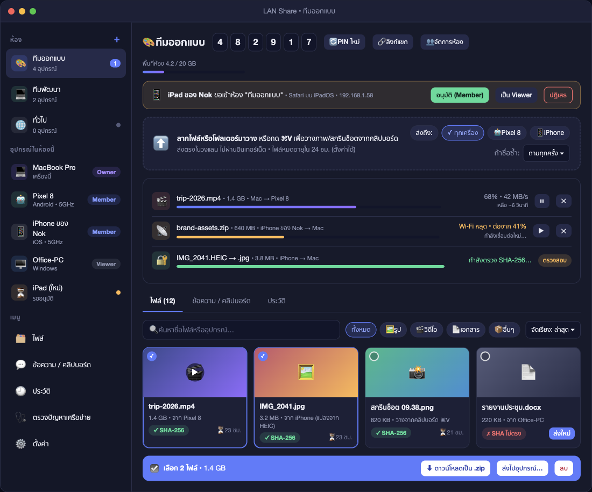
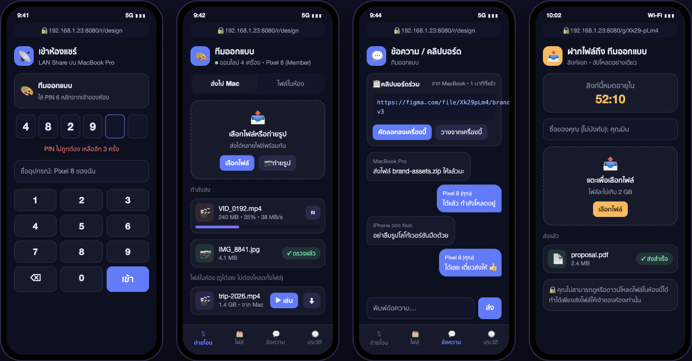
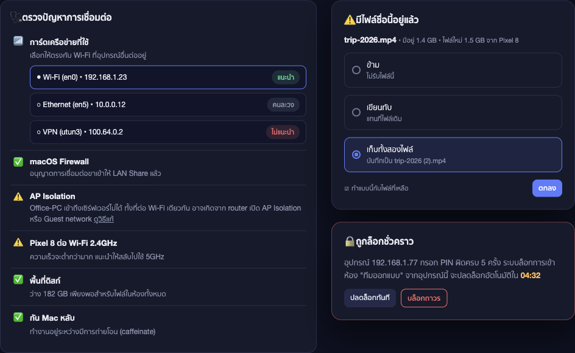
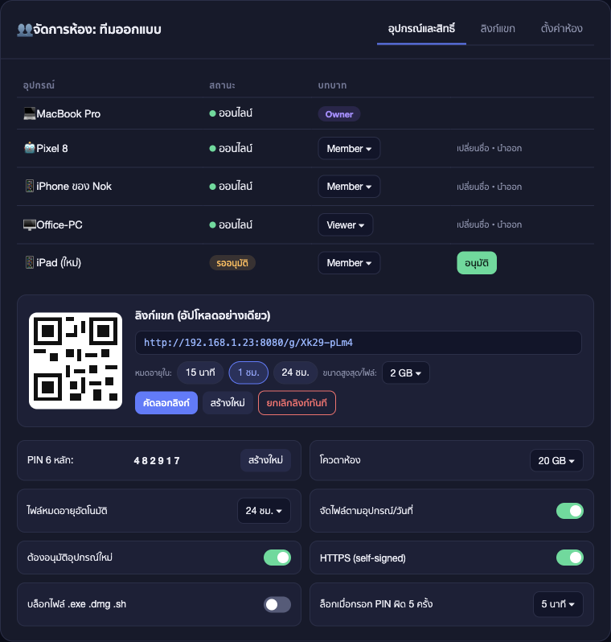
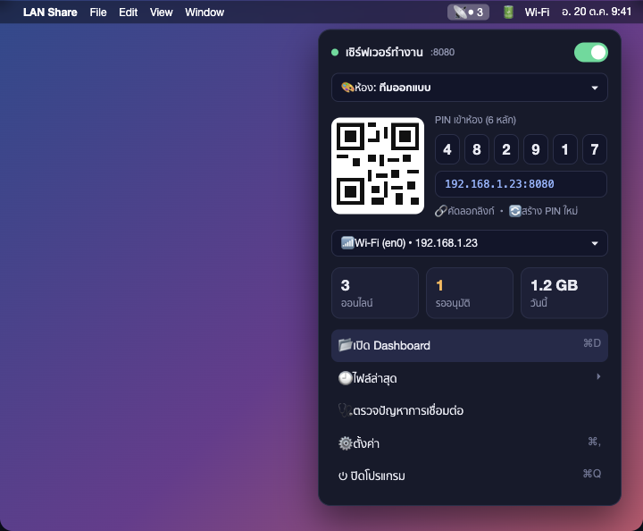

# Share Group

เซิร์ฟเวอร์แชร์ไฟล์ในวง LAN รันบนเครื่องโฮสต์ แล้วให้อุปกรณ์อื่นเข้าผ่านเบราว์เซอร์ ไม่ต้องติดตั้งแอปลูกข่าย

เวอร์ชัน `0.2.1` · ผู้พัฒนา `nooartskyline`

[โหลด 0.2.1](https://github.com/NooartSkyline/share-group/releases/latest) · รุ่นเก่าเก็บใน [`dist/`](dist/) และหน้า [Releases](https://github.com/NooartSkyline/share-group/releases)

ค่าเริ่มต้นเป็น HTTP ธรรมดา ใช้ในวงที่ไว้ใจกันได้ ถ้าจะเปิดให้คนอื่นเข้า ให้ใช้ `-tls` และเปิดอนุมัติอุปกรณ์ในหน้า Owner

ภาพรวมระบบ ข้อมูลนักพัฒนา และต้นแบบ UI อยู่ที่ [`docs/project-scope.md`](docs/project-scope.md) หัวข้อ 13–15

## โหลด

ลูกข่ายยังใช้เบราว์เซอร์ ติดตั้งเฉพาะเครื่องที่จะเป็นโฮสต์ ไฟล์ยังไม่ลงนาม กดแล้วได้ไฟล์จาก [GitHub Releases](https://github.com/NooartSkyline/share-group/releases)

หน้าปุ่มโหลด: [`dist/index.html`](dist/index.html)

| เวอร์ชัน | macOS | Android | Windows (amd64) |
|---|---|---|---|
| **0.2.1** (ปัจจุบัน) | [โหลด .dmg](https://github.com/NooartSkyline/share-group/releases/download/v0.2.1/Share-Group-0.2.1-macos.dmg) | [โหลด .apk](https://github.com/NooartSkyline/share-group/releases/download/v0.2.1/Share-Group-0.2.1-android.apk) | [โหลด .zip](https://github.com/NooartSkyline/share-group/releases/download/v0.2.1/Share-Group-0.2.1-windows-amd64.zip) |
| 0.2.0 | [โหลด .dmg](https://github.com/NooartSkyline/share-group/releases/download/v0.2.0/Share-Group-0.2.0-macos.dmg) | [โหลด .apk](https://github.com/NooartSkyline/share-group/releases/download/v0.2.0/Share-Group-0.2.0-android.apk) | [โหลด .zip](https://github.com/NooartSkyline/share-group/releases/download/v0.2.0/Share-Group-0.2.0-windows-amd64.zip) |
| 0.1.0 | [โหลด .dmg](https://github.com/NooartSkyline/share-group/releases/download/v0.1.0/Share-Group-0.1.0-macos.dmg) | — | — |

- **macOS:** เปิด `.dmg` แล้วลาก Share Group ไป Applications ไอคอนอยู่บน menu bar ไม่โผล่ที่ Dock ถ้าขึ้นว่าแอปเสียหาย (damaged) อย่าทิ้งไฟล์ — คลิกขวาแล้วเลือกเปิด หรือรัน `xattr -dr com.apple.quarantine "/Applications/Share Group.app"` รายละเอียดอยู่ใน `วิธีติดตั้ง.txt` ใน `.dmg`
- **Android:** เปิด `.apk` บนเครื่อง (sideload) อนุญาตติดตั้งจากไฟล์ แดชบอร์ดในแอป ใช้ได้ขณะแอปเปิดหรือมี foreground service
- **Windows:** แตก zip แล้วเปิด `ShareGroup.exe` ให้ `lanshare.exe` กับ `share.exe` อยู่โฟลเดอร์เดียวกัน แดชบอร์ดเปิดในเบราว์เซอร์ที่ `http://127.0.0.1:8080` ยังไม่มีเครื่องเทสบน Windows จริง
- **iOS:** ยังไม่มีไฟล์ IPA ใน `dist/` เปิด `mobile/ios/ShareGroupHost.xcodeproj` ใน Xcode แล้ว Run บนเครื่อง

สร้างไฟล์ติดตั้งชุดปัจจุบันใหม่ด้วย `sh scripts/package-hosts.sh` (อ่านเวอร์ชันจากไฟล์ `VERSION`)

## ระบบ

- **หลังบ้าน:** โปรแกรม Go (`cmd/lanshare`) เปิด HTTP + WebSocket ที่พอร์ต `8080` เก็บห้อง ไฟล์ และสิทธิ์บนดิสก์เครื่องโฮสต์
- **หน้าเว็บ:** `web/` ฝังในไบนารี เครื่องอื่นใช้เบราว์เซอร์อย่างเดียว
- **เปลือกโฮสต์:** Mac menu bar, ถาดระบบ Windows, แอป Android / iOS ห่อแกน Go เดียวกัน
- **ต้นแบบ:** `mock/ui-mock-v3.html` คลิกดูหน้าตา ไม่ต่อเซิร์ฟเวอร์

## หน้าตา

ภาพจากต้นแบบ [`mock/ui-mock-v3.html`](mock/ui-mock-v3.html)

แดชบอร์ดบน Mac



ฝั่งมือถือในเบราว์เซอร์: กรอก PIN, ส่งไฟล์, ข้อความ และลิงก์แขก



ตรวจปัญหาการเชื่อมต่อ และกล่องถามเมื่อชื่อไฟล์ซ้ำ



จัดการห้อง บทบาท และลิงก์แขก



Popover จากไอคอน menu bar



## สิ่งที่ต้องมี

- macOS (เครื่องที่รันเซิร์ฟเวอร์)
- Go 1.27 ขึ้นไป

นักพัฒนา: รัน `sh scripts/run-local.sh` แล้วเปิด `http://localhost:8080` เทสต์ด้วย `go test ./...` และ `node --test web/test/` รายละเอียดหัวข้อ 14 ในเอกสารขอบเขต

## รัน

จากโฟลเดอร์โปรเจกต์:

```bash
sh scripts/run-local.sh
```

Wi-Fi และสาย USB เข้าเซิร์ฟเวอร์ตัวเดียวกัน กรอก PIN เดียวกัน ถ้ามีเซิร์ฟเวอร์ทำงานอยู่แล้ว (เช่น แอป menu bar ที่พอร์ต `8080`) สคริปต์จะไม่เปิดตัวใหม่ แค่เชื่อมสาย USB เข้าเซิร์ฟเวอร์นั้น มือถือที่เสียบสายเปิด `http://127.0.0.1:8080/?r=main` ได้โดยไม่ต้องมีเน็ต

ถ้ายังไม่มีเซิร์ฟเวอร์ จะ build แล้วรันจากซอร์สที่พอร์ต `8080` ข้อมูลอยู่ที่ `./tmp/local` หยุดด้วย Ctrl+C

หรือรันตรง ๆ:

```bash
go run ./cmd/lanshare
```

เซิร์ฟเวอร์เปิดที่พอร์ต `8080` และเก็บไฟล์กับสถานะไว้ที่ `~/LANShare` ตอนเริ่มจะพิมพ์ที่อยู่ของเครื่องนี้, URL สำหรับอุปกรณ์อื่น, QR code, ชื่อห้อง และ PIN

บน Mac เปิด `http://localhost:8080` แล้วเข้าเป็น Owner อัตโนมัติ ไม่ต้องใส่ PIN

อุปกรณ์อื่นต้องอยู่ Wi-Fi เดียวกัน เปิด URL ที่พิมพ์ออกมา (รูป `http://<IP>:8080/?r=main`) หรือสแกน QR แล้วกรอก PIN เดียวกัน

หยุดด้วย Ctrl+C

## คำสั่งที่ใช้บ่อย

```bash
go run ./cmd/lanshare -port 9000 -data ./tmp
go run ./cmd/lanshare -iface en0
go run ./cmd/lanshare -h
```

| Flag | ค่าเริ่มต้น | ความหมาย |
|---|---|---|
| `-port` | `8080` | พอร์ต HTTP |
| `-data` | `~/LANShare` | โฟลเดอร์เก็บไฟล์และสถานะ |
| `-iface` | อัตโนมัติ | การ์ดเครือข่ายที่โฆษณาให้เครื่องอื่น เช่น `en0` |
| `-room-name` | `ห้องหลัก` | ชื่อห้องเริ่มต้น |
| `-min-free` | `1GiB` | พื้นที่ว่างที่ต้องเหลือหลังรับไฟล์ หน่วยเป็น `B`, `KiB`, `MiB` หรือ `GiB` |
| `-upload-ttl` | `24h` | ระยะเวลาเก็บอัปโหลดที่ยังไม่เสร็จ อย่างน้อย `1m` |
| `-stall-timeout` | `30s` | ตัดคำขออัปโหลดที่ไม่มีข้อมูลเข้า อย่างน้อย `5s` |
| `-keep-awake` | `true` | กัน Mac หลับระหว่างมีการโอน ปิดด้วย `-keep-awake=false` |
| `-system-preview` | `true` | พรีวิว HEIC, RAW, PDF ด้วยเครื่องมือ macOS ปิดด้วย `-system-preview=false` |
| `-max-pin-failures` | `5` | จำนวนครั้งที่กรอก PIN ผิดก่อนถูกล็อก |
| `-lockout` | `5m0s` | ระยะเวลาล็อกหลังกรอก PIN ผิดเกินกำหนด |
| `-tls` | `false` | เปิด HTTPS ด้วยใบรับรอง self-signed ในโฟลเดอร์ข้อมูล |

ตัวอย่าง:

```bash
go run ./cmd/lanshare -min-free 5GiB -upload-ttl 48h -stall-timeout 60s -keep-awake=false
```

## สร้างไบนารี

```bash
go build -o lanshare ./cmd/lanshare
./lanshare
```

หน้าเว็บถูกฝังในไบนารีแล้ว จึงรันจากโฟลเดอร์อื่นได้

## ส่งไฟล์จากเทอร์มินัล

เซิร์ฟเวอร์ต้องเปิดอยู่บนเครื่องนี้ แล้ว:

```bash
go run ./cmd/share send photo.jpg
go run ./cmd/share send -port 9000 ./report.pdf
```

คำสั่งนี้เข้าเป็น Owner ผ่าน `localhost` แล้วอัปโหลดไฟล์เข้าห้องปัจจุบัน

ติดตั้ง Finder Quick Action:

```bash
sh desktop/FinderQuickAction/install.sh
```

จากนั้นใน Finder คลิกขวาไฟล์ → Quick Actions / Services → **ส่งไป Share Group** (เซิร์ฟเวอร์ต้องเปิดอยู่)

## แอป menu bar

สร้างและเปิดไอคอนบนแถบเมนู (ไม่โผล่ที่ Dock) ด้วย Swift AppKit:

```bash
sh desktop/LanShareMenu/install.sh
```

แพ็กเป็นไฟล์ติดตั้ง `.dmg` (มีแอปและลิงก์ไป Applications):

```bash
sh desktop/LanShareMenu/dmg.sh
```

ได้ไฟล์ที่ `dist/<เวอร์ชัน>/Share Group-<เวอร์ชัน>.dmg` ถ้าเรียกผ่าน `scripts/package-hosts.sh` หรือที่พาธที่ส่งเป็นอาร์กิวเมนต์ เปิดแล้วลากแอปไป Applications แอปยังไม่ลงนาม เครื่องอื่นอาจต้องคลิกขวาแล้วเลือกเปิด

เมนูแสดงห้อง, PIN, เครือข่าย, จำนวนอุปกรณ์ และอุปกรณ์ที่รออนุมัติ กดเปิดแดชบอร์ดหรือเปิดเมื่อเข้าสู่ระบบได้จากเมนู

## Shortcuts และ HTTP บนเครื่องนี้

เรียกได้เฉพาะจาก `127.0.0.1` / `localhost` ไม่ต้องใส่ PIN:

| Method และ path | หน้าที่ |
|---|---|
| `GET /api/shortcuts/info` | ห้อง, PIN, URL, โควตา, จำนวนอุปกรณ์ |
| `GET /api/shortcuts/qr.png` | QR ของลิงก์เข้าห้อง |
| `GET /api/shortcuts/files` | รายการไฟล์ในห้องปัจจุบัน |
| `POST /api/shortcuts/files?name=photo.jpg` | อัปโหลดเนื้อหาไฟล์จาก body |

ในแอป Shortcuts ใช้ Get Contents of URL ชี้ `http://127.0.0.1:8080/...`

รูป HEIC/HEIF ที่อัปโหลดบน Mac จะถูกแปลงเป็น JPG อัตโนมัติด้วย `sips` หลังส่งเสร็จ ไฟล์ข้อความเปิดดูในหน้าเว็บพร้อมระบายสี syntax พรีวิว HEIC, RAW, PDF และเอกสารใช้เครื่องมือ macOS (`sips` / Quick Look) เปิดไว้เป็นค่าเริ่มต้น ปิดด้วย `-system-preview=false` ถ้าไม่ไว้ใจไฟล์จากเครื่องอื่น

ในหน้าเว็บ: อัปโหลดที่หลุดระหว่างทางมีปุ่มหยุด/ต่อ กดไฟล์แล้วเทียบ SHA-256 กับไฟล์ในเครื่องได้ Owner ยกเลิกอัปโหลดที่ค้างได้จากแผงห้อง เมนูตั้งค่า (ธีม ภาษา ย่อรูป ตรวจ checksum แจ้งเตือน) อยู่แถบซ้ายหรือแท็บล่าง เมนูตรวจปัญหาการเชื่อมต่อมีเฉพาะ Owner โฟลเดอร์บนมือถือที่เสียบสายแสดงได้ไม่เกิน 400 รายการต่อหน้า (กันรายการยาวเกินไป) การบันทึกทั้งโฟลเดอร์เป็น zip ยังดึงได้ถึง 5000 ไฟล์

## HTTPS

```bash
go run ./cmd/lanshare -tls
```

ใบรับรองอยู่ที่ `~/LANShare/tls` เบราว์เซอร์จะเตือน self-signed ให้กดดำเนินการต่อ บน iOS อาจต้องติดตั้งโปรไฟล์ใบรับรองเอง

## ทดสอบ

```bash
go test ./...
```

## ต้นแบบ UI

ไฟล์ปัจจุบันคือ [`mock/ui-mock-v3.html`](mock/ui-mock-v3.html) เปิดในเบราว์เซอร์โดยไม่ต้องรันเซิร์ฟเวอร์ เข้าเป็น Owner ทันที กดออกจากห้องเพื่อดูจอ PIN (ทดลอง `482916`) รายการสิ่งที่ตรง/ไม่ตรงหน้าจริงอยู่หัวข้อ 15 ของเอกสารขอบเขต
